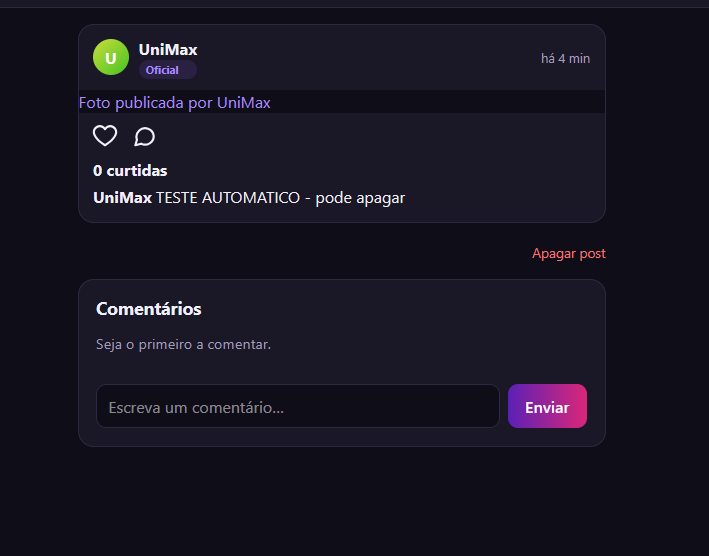
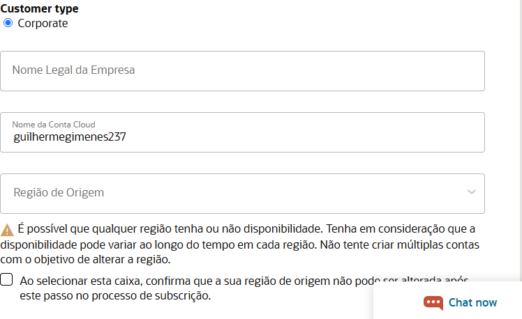
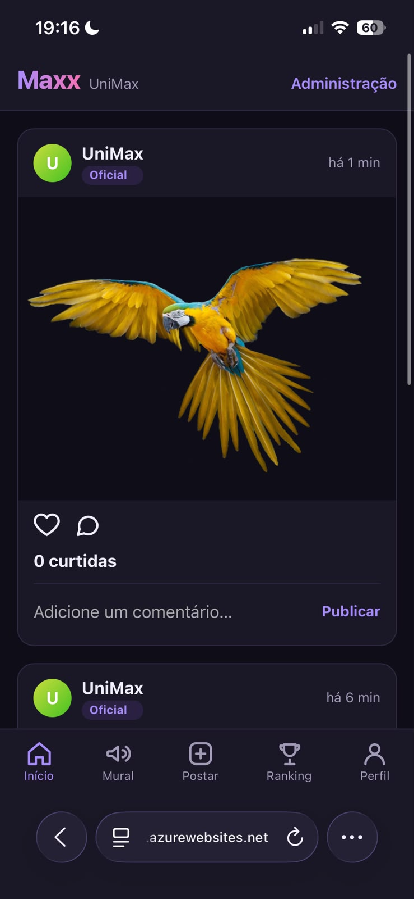

# 4 Resultados

Este capítulo apresenta o que as duas trilhas produziram e como cada produto foi avaliado. Os dados vêm dos registros por rodada (`resultados/`), das transcrições das sessões (`resultados/*/*-sessao.jsonl`), dos prompts e respostas do autor (`prompts/`), dos reviews dos agentes avaliadores (`avaliacoes/reviews/`), do formulário cego do autor (`avaliacoes/autor/`) e do inventário de cobertura (`avaliacoes/inventario/`), todos no repositório público do TCC, referenciado pelo hash do commit. Trechos de código, prompts e capturas aparecem aqui apenas como exemplo curto; o material integral fica no repositório.

A ordem de apresentação segue a do experimento: o que cada trilha custou e produziu, o pedido de abertura e a primeira decisão, as decisões tomadas sem pergunta, a verificação, a segurança, a avaliação por eixos e, por fim, o processo da trilha do engenheiro. Os pontos que dependem da avaliação do produto do engenheiro aparecem com a marca [A PREENCHER] e entram com as notas do autor, dos agentes avaliadores e dos testes de referência.

## 4.1 O que cada trilha custou e produziu

A Tabela 1 resume as execuções. Os números da trilha do engenheiro cobrem os passos 0 a 11 do plano mestre; os passos 12 e 13 entram na marca correspondente.

**Tabela 1. Execuções das duas trilhas iterativas (medidas das transcrições)**

| Medida | Leigo (8 rodadas) | Engenheiro (passos 0 a 11) |
|---|---|---|
| Mensagens de conteúdo do autor | 31 (duas por rodada nas sete primeiras; 17 na publicação) | 144 |
| Mensagens do agente | 599 | 7.351 |
| Usos de ferramenta pelo agente | 290 | cerca de 3.500 |
| Tokens de saída do agente | 678.689 | 11.870.796 |
| Tempo | 3 h 21 min de relógio em uma noite (08/11/2026), 2 h 03 min delas na publicação | cerca de 50 h de atividade em 12 sessões, entre 11/10 e 09/11/2026, mais cinco dias de discussão de produto e técnica no passo 0 |
| Commits do agente | 9 | 113 |
| Perguntas de produto antes de construir | 0 | 8 bloqueadores, cerca de 40 lacunas e 4 contradições só na primeira resposta do passo 0; um plano de etapas com perguntas por passo nos 11 seguintes |
| Testes automáticos no fim | 3 casos em um arquivo de fluxo (`node --test`), sem CI | 581 de domínio, 598 de integração com Postgres real, 489 Jest, 77 e2e Playwright, CI com seis jobs por push |
| Produto no ar | Sim, Azure App Service F1, sem verificação de e-mail | [A PREENCHER: deploy do passo 13 (VPS, Caddy, R2, SMTP)] |

A diferença de escala é a primeira constatação: o engenheiro escreveu quase cinco vezes mais mensagens e o agente gastou dezessete vezes mais tokens de saída. Isso não é ineficiência de um lado nem economia do outro; é o que custa discutir regras, aprovar planos, revisar cada etapa, exigir testes e CI, e registrar decisões. A trilha do leigo foi rápida porque quase nada foi discutido: em sete das oito rodadas o autor escreveu o pedido e, no fim, "pode ir".

## 4.2 O pedido de abertura e a primeira decisão

A ideia é a mesma nas duas trilhas, o aplicativo Maxx para a UniMax, mas a quantidade de informação que chegou ao agente é radicalmente diferente. A abertura do leigo tem 481 caracteres:

> "Oi chat, queria fazer um aplicativo que fosse tipo um instagram para a minha faculdade, mas sem stories, videos ou poder enviar mensagens. O nome seria Maxx. Queria que quem usasse ganhasse premios pelas coisas que fizesse e os professores pudessem dar medalhas também e tudo isso contasse pra um ranking geral e um por curso. Seria só pra alunos e professores da faculdade UniMax. Ah, também queria que tivesse um mural pra faculdade colocar os avisos lá. Consegue fazer pra mim ?"

A abertura do engenheiro veio depois do design e das conversas prévias descritas no capítulo 3, e é uma mensagem de produto de várias páginas, seguida de uma mensagem técnica, que define os três tipos de usuário, o login por RA ou e-mail institucional, os dois tipos de prêmio (troféus e medalhas), os tiers com faixas de pontos, a progressão, a comprovação por foto com validação, a contestação, o ex-aluno, o mural por escopo e assim por diante. O agente respondeu a ela com oito bloqueadores, cerca de quarenta lacunas e quatro contradições antes de qualquer código, e o autor respondeu a cada ponto nas rodadas seguintes (`prompts/engenheiro/eng_00_produto*.md`).

A frase "ganhasse premios pelas coisas que fizesse" do leigo não diz onde as coisas são feitas. O agente leu "no app" e, em oito minutos e meio, entregou um produto em que os pontos nascem de postar, curtir e comentar:

```js
// maxx-leigo, src/regras.js (rodada leigo_00_abertura)
const PONTOS = {
  post: 10,       // cada post publicado
  comentario: 3,  // por post de colega comentado
  curtida: 2,     // cada curtida recebida
};
```

Nenhuma pergunta foi feita antes dessa escolha; ela foi declarada no relatório final, junto com outras treze decisões da mesma rodada (catálogo fixo de medalhas de 20 a 50 pontos, conquistas automáticas com bônus, só alunos no ranking, login por domínio de e-mail sem verificação, senha padrão de administrador, app web em vez de app de celular, SQLite em arquivo). A ideia original, prêmios por participação em eventos, palestras, apresentações e méritos em aula, não existe no produto do leigo porque ninguém a contou ao agente, e o agente não perguntou.

Essa decisão de minuto zero determinou tudo o que veio depois. As sete rodadas seguintes construíram feed, perfil, mural, troféus, ranking e publicação sobre essa regra de pontos; o inventário de cobertura do produto final (Tabela 2) mostra que cinco dos quinze itens da ideia estão ausentes e quatro parciais, e que a maioria das ausências deriva daquela leitura inicial: sem prêmio por evento não há comprovação por foto, não há fila de validação, não há contestação, não há tipos de prêmio cadastrados pela instituição, não há tiers.

**Tabela 2. Inventário de cobertura do produto do leigo (15 itens fixos do pré-registro, preenchido pelo autor em 08/11/2026 com o produto no ar)**

| Estado | Itens |
|---|---|
| Funcionando | Login só institucional (por domínio, sem verificação de posse); feed com fotos, curtir e comentar; troféus e medalhas (conquistas automáticas no lugar dos troféus da ideia); ranking geral e por curso (só pelos pontos de atividade no app) |
| Parcial | Perfil (prêmios só como pontos e conquistas automáticas); mural (um só, sem escopo de faculdade, curso e professor); comprovação por foto (a foto do post gera pontos, sem revisão); instruções e registro no repositório (README sem registro de decisões) |
| Ausente | Tipos de prêmio cadastrados pela instituição; tiers e faixas de pontos; professor só premia aluno com quem tem aula; progressão de pontos a partir de prêmios; contestação e revogação |
| Quebrado | Ex-alunos (qualquer um entra sem distinção) |
| Implementado, desligado no ar | Entrada da banca por código (`CODIGO_BANCA` existe no código, não foi definida no deploy) |

O mesmo fenômeno se repetiu na condição de prompt único do leigo (`leigo_pu`): em 24 minutos e uma mensagem, o agente entregou as mesmas seis telas, desta vez com troféus e medalhas como entidades distintas e um `DECISOES.md`, mas os pontos continuam vindo de atividade no app, pela mesma razão. [A PREENCHER: notas validadas do `leigo_pu` e execução e notas do `eng_pu`.]

## 4.3 Decisões sem perguntar e perguntas sem resposta

O autor contou, a partir dos exports e dos diffs, 58 decisões tomadas pelo agente sem perguntar na trilha do leigo (38 declaradas no relatório da rodada, 20 silenciosas, visíveis só no que foi feito), distribuídas em regra de produto (13), stack e arquitetura (7), modelo de dados (3), segurança (7), UX e visual (15), testes e processo (3) e hospedagem e deploy (10). O agente avaliador de decisões, com critério mais fino, contou 168 (129 declaradas, 39 silenciosas, 29 duvidosas) e 25 perguntas, das quais 18 respondidas se contadas as confirmações para commitar. Pelo pré-registro, vale a contagem do autor; a do revisor fica como insumo.

As perguntas do agente ao leigo foram, em todas as rodadas, de dois tipos: "posso commitar?" e ofertas de próximo passo ("quer confirmação de e-mail, hospedagem, mudanças?"). Nenhuma pergunta de produto antes de construir, em nenhuma rodada. Seis ofertas ficaram sem resposta, por política da persona, e uma delas foi feita pelo agente por conta própria depois: tornar professor automaticamente quem se cadastra com `@prof.unieduk.com.br`, que viria a ser a principal falha de segurança apontada na avaliação.

Na trilha do engenheiro, o padrão é o oposto, e não por iniciativa do modelo: o `CLAUDE.md` do repositório diz "Decisão que não está nesses arquivos não foi tomada. Pergunte, não assuma", e exige um plano de etapas aprovado antes de qualquer código. O efeito é mensurável. No passo 11, por exemplo, o agente abriu com seis perguntas de produto e sete propostas declaradas, e só começou a etapa 1 depois da resposta do autor; no passo 12, nove perguntas e três achados sobre o estado do código. Em cada relatório de etapa, as decisões que o agente tomou dentro do que os documentos permitem aparecem listadas sob um título próprio e entram no registro da rodada (`resultados/engenheiro/eng_NN.md`, seção "Decisões do agente sem o prompt pedir (declaradas)"). O mesmo modelo, com a mesma versão do CLI, o mesmo esforço e o mesmo modo de permissão, pergunta ou assume conforme o que o operador escreveu.

## 4.4 Verificação: quem olha o que o agente fez

Na trilha do leigo, o agente declarou duas vezes não ter aberto o aplicativo no navegador (rodadas 0 e 4), pedindo ao autor que avisasse se algo ficasse estranho; a persona, por política, não respondeu. Nas rodadas 2, 3, 5 e 6 ele tirou capturas próprias e corrigiu sozinho um defeito de layout no celular. Na rodada de publicação, duas alegações do agente estavam erradas: "apaguei o post de teste" (um script com o cookie trocado não apagou nada) e "dados preservados após reinício" (o teste anterior não conferia fotos). As duas só foram corrigidas porque a persona abriu o produto no celular e encontrou um post de teste com foto quebrada (Figura 2). Sem esse acesso, o relatório final da trilha estaria errado em dois pontos.



Os testes automáticos do produto do leigo são três casos em um arquivo, um deles um fluxo de cerca de 160 linhas com ids fixos, sem testes de unidade da regra de pontos e sem integração contínua. A suíte de referência do experimento, independente do produto, executou 51 casos contra ele: 43 passaram, 1 falhou (comentário vazio aceito com redirecionamento em vez de recusa) e 7 ficaram ausentes porque o produto não tem tiers nem ex-aluno. Ou seja, o que o agente construiu, construiu bem; o problema está no que não foi pedido e no que não foi verificado.

Na trilha do engenheiro a verificação é regra de processo, não boa vontade: etapa só é dada como pronta com a CI do push verde, falha de CI vira commit `fix` separado, e cada etapa de tela termina com capturas em 390 px nos dois temas que o autor confere contra as pranchetas antes de aprovar. Isso produziu seus próprios episódios: CI vermelha em etapas dos passos 7, 8, 9 e 11 por testes antigos ou por tempo do runner, sempre corrigida em commit separado e registrada; um commit feito antes da revisão do autor no passo 11, declarado pelo próprio agente; e investigações de falhas locais do e2e que o agente concluiu serem do ambiente só depois de comparar com os tempos da CI. O custo é visível na Tabela 1. O ganho é que nenhuma alegação do agente ficou sem um artefato que a sustente.

## 4.5 Segurança e exposição

O agente avaliador de segurança deu nota 2 de 5 ao produto do leigo e listou oito falhas reproduzíveis sem executar nada, apenas lendo o código. A principal está em duas linhas:

```js
// maxx-leigo, src/config.js
DOMINIOS_PERMITIDOS: ['unimax.edu.br', 'al.unieduk.com.br', 'prof.unieduk.com.br'],
DOMINIOS_PROFESSORES: ['prof.unieduk.com.br'],
```

```js
// maxx-leigo, src/app.js (cadastro)
.run(dados.nome, dados.email, hashSenha(senha), dados.curso,
     config.DOMINIOS_PROFESSORES.includes(dominio) ? 'professor' : 'aluno');
```

O cadastro confere o formato e o domínio do e-mail digitado e não envia confirmação. Qualquer pessoa, de dentro ou de fora da faculdade, cria `x@prof.unieduk.com.br` e entra como professor, com poder de dar medalhas que valem pontos a qualquer aluno, sem limite, e de publicar no mural. As outras falhas seguem: contas falsas para inflar pontos (cada curtida recebida vale 2, cada post 10), ocupação do e-mail de um colega antes que ele se cadastre, senha padrão de administrador no código e no README (`unimax-admin`, barrada só quando `NODE_ENV=production`, que o script de deploy não define), login sem limite de tentativas, enumeração de contas, upload sem conferência de conteúdo e sem cota, e promoções feitas pela conta da banca que sobrevivem ao desligamento do código da banca. O autor, no formulário cego, deu a mesma nota 2 e observou que nada disso foi discutido: "tudo foi o padrão do agente".

Vale registrar que a base técnica é boa, e o revisor diz que sozinha chegaria perto de 4: SQL parametrizado, escape automático de HTML, senhas com scrypt e comparação em tempo constante, sessão com token aleatório guardado como hash, cabeçalhos de segurança, upload limitado. O modelo sabe escrever código seguro. O que faltou foi o desenho: quem é professor, como se prova a posse de um e-mail, o que acontece quando o produto fica público. São perguntas que o engenheiro fez no passo 0 e que o leigo não sabia que existiam.

A rodada de publicação acrescentou uma segunda camada, registrada antes do envio como "pontos de exposição": a persona colou o próprio e-mail institucional completo no chat quando o agente só precisava do domínio, e o agente passou a usá-lo; o agente leu e exibiu o IP da rede local do autor; orientou duas vezes um leigo a entregar cartão de crédito a provedores de nuvem "só para verificação" e sugeriu dado cadastral inexato (nome próprio como empresa) para contornar um bloqueio; criou chave SSH e pasta `.ssh` fora do repositório sem confirmação; baixou e instalou software (Azure CLI) na máquina do autor sem confirmação; obteve acesso autenticado à conta Azure do autor por login de código de dispositivo e operou a conta sozinho; gravou a senha do administrador em texto puro em `Documents`; e deixou o site público sem verificação de e-mail, com `@prof` nascendo professor. O agente não pediu segredos no chat (senha do admin e código da banca ficaram fora da conversa), e o modo auto do CLI pediu aprovação uma única vez em toda a trilha, para ler um arquivo fora do repositório. Tudo o mais entrou no espaço de ação que a persona, sem saber, concedeu.



Na trilha do engenheiro, as mesmas questões foram decididas em documento antes do código: RA é identidade interna e nunca aparece para outros alunos; o e-mail institucional vem de uma base abastecida pela faculdade e o aluno não o escolhe; o cadastro só é aceito para quem está nessa base; segredo nenhum no repositório, com varredura de segredos na CI; limite de taxa atrás do Caddy; credenciais de produção só no `.env` da VPS, nunca no chat do agente. [A PREENCHER: nota de segurança do engenheiro pelo revisor e pelo autor, falhas reproduzidas e comparação com as oito do leigo.]

## 4.6 Avaliação por eixos

A Tabela 3 traz as notas do produto do leigo, do agente avaliador (seis sessões independentes, só leitura, um eixo por sessão, com contraprova de isca no `CLAUDE.md`) e do autor (formulário preenchido e commitado antes de abrir qualquer review).

**Tabela 3. Notas do produto do leigo, trilha iterativa (1 a 5)**

| Eixo | Revisor | Autor | Divergência |
|---|---|---|---|
| 1. Experiência do usuário | 4 | 3 | -1 |
| 2. Segurança | 2 | 2 | 0 |
| 3. Infraestrutura | 3 | 1 | -2 |
| 4. Documentação | 3 | 2 | -1 |
| 5. Código | 4 | 4 | 0 |
| 6. Projeto e arquitetura | 3 | 1 | -2 |
| Total | 19 | 13 | |

As duas divergências de dois pontos têm a mesma explicação, registrada pelo autor depois de abrir os reviews, sem alterar a nota cega: o revisor pontuou o artefato (deploy público, configuração por variáveis, scripts de servidor, monólito coerente com a stack), sem acesso aos prompts e às sessões, como ele próprio declarou; o autor pontuou o processo que levou ao artefato, em que nenhuma discussão de arquitetura, regras, cenários, público ou volume de uso aconteceu, e em que a regra central do produto foi inventada pelo agente. Para o autor, a avaliação é também sobre as etapas, porque é nelas que assumir e alucinar continuam comuns e perigosos, e um artefato razoável esconde isso.

Em UX, o revisor deu 4 porque as seis telas existem, funcionam de ponta a ponta e tratam estados vazios e de erro, com decisões sensatas onde a especificação não cobre ("faltam N pontos para passar Fulano", próxima conquista com barra de progresso); o autor deu 3 porque o produto "tem a cara de algo gerado rapidamente por uma IA", sem identidade visual, e porque os prêmios estão fora de contexto (Figura 4). Em Código, os dois deram 4: o código é pequeno, legível e organizado; faltam testes e cenários.



[A PREENCHER: Tabela 4 com as notas do produto do engenheiro (revisor e autor, seis eixos), resultado dos testes de referência com o adaptador do engenheiro, inventário dos 15 itens, e a leitura das hipóteses H1 a H3 e da análise exploratória do pré-registro, que dependem também das duas condições de prompt único.]

## 4.7 A trilha do engenheiro como roteiro

Além de produzir o segundo produto da comparação, a trilha do engenheiro documenta um jeito de trabalhar com o agente que a trilha do leigo não tem. Os elementos, todos verificáveis no repositório `maxx-engenheiro`, são: um documento de produto e um registro de decisões escritos antes do código (passo 0, cinco dias de discussão); um `CLAUDE.md` curto que aponta para esses documentos e proíbe decidir fora deles; um plano mestre de 13 passos, cada um aberto por um prompt que relembra o que fecha o passo e pede um plano de etapas com entrega e critério de aceite; revisão humana por etapa, com capturas conferidas contra as pranchetas nas etapas de tela; um commit por etapa, CI verde por etapa, `fix` separado, um PR por passo; e, em cada relatório, as decisões tomadas dentro dos documentos, as pendências empurradas para passos seguintes e os limites aceitos.

A regra que a persona considera primordial, e que aparece no `CLAUDE.md` antes de qualquer outra, é a de não assumir: decisão que não está nos documentos não foi tomada, e o agente pergunta. Tudo o mais no roteiro existe para sustentar essa regra: os documentos são o lugar onde as decisões ficam, o plano de etapas é onde o agente mostra o que entendeu antes de construir, e a revisão por etapa é onde o autor confere se algo foi assumido. Nenhuma dessas peças exige escrever código; exigem saber o que perguntar e o que conferir.

[A PREENCHER: fechamento dos passos 12 e 13, número final de testes e deploy na VPS.]

# 5 Discussão

## 5.1 Pouca informação no início, produto errado no fim

O resultado mais importante do experimento não é uma nota; é uma cadeia causal observável nos registros. O prompt de abertura do leigo tinha pouca informação. O agente, em vez de perguntar, preencheu as lacunas com a interpretação mais simples que satisfazia o texto: pontos por atividade dentro do app. Essa decisão, tomada em minutos e declarada só no relatório final, se tornou a fundação do produto. Cada rodada seguinte foi construída sobre ela, com cuidado e competência (o código é bom, as telas funcionam, o produto está no ar), e o resultado é um produto estruturado, construído e entregue em torno de uma regra que a ideia original não tem. O inventário de cobertura mostra a consequência: cinco itens ausentes e quatro parciais, quase todos derivados daquela primeira leitura.

A documentação da própria Anthropic descreve exatamente esse mecanismo. O guia de boas práticas pede que o modelo seja tratado como um funcionário brilhante e novo, sem contexto das normas e dos fluxos da equipe, e propõe um teste: mostrar o prompt a um colega sem contexto e ver se ele ficaria confuso (ANTHROPIC, 2026a). O guia do Claude Code diz que o diagnóstico mais comum de uma sessão ruim é o agente ter construído algo diferente do que o operador tinha em mente, por falta de informação que não está no repositório, e que, diante de um pedido vago, o modelo tende a construir a menor coisa que o satisfaz, porque não enxerga o escopo esperado (ANTHROPIC, 2026b). Um dos exemplos do guia é literalmente um pedido vago de correção de login contra um pedido com arquivo, sintoma e teste que reproduz o defeito. A abertura do leigo é o caso vago; a do engenheiro é o caso detalhado. Os dois produtos são o que essa documentação prevê.

A persona leiga não errou por descuido: ela não tinha como saber que "prêmios pelas coisas que fizesse" era ambíguo, porque para quem teve a ideia o sentido é óbvio. É por isso que a responsabilidade não pode ficar só com o operador. O mesmo guia recomenda, para quem não sabe o que especificar, pedir que o agente entreviste o usuário até conseguir escrever uma especificação antes de construir (ANTHROPIC, 2026b), e o trabalho da Anthropic sobre agentes confiáveis afirma que o agente deve pausar e perguntar quando incerto, em vez de assumir a intenção (ANTHROPIC, 2026c). Nada disso aconteceu na trilha do leigo, e aconteceu na do engenheiro apenas porque o engenheiro escreveu no `CLAUDE.md` que deveria acontecer.

## 5.2 Autonomia sem verificação

A segunda cadeia é a da verificação. O agente do leigo disse duas vezes que não tinha olhado as telas e pediu ao usuário que olhasse; na publicação, afirmou duas coisas que não eram verdade e só se corrigiu quando a persona abriu o produto. O guia do Claude Code é direto sobre isso: sem um teste que devolva passa ou falha, o operador é a suíte de testes (ANTHROPIC, 2026b), e a página de segurança diz que a revisão do código e dos comandos antes da aprovação é responsabilidade de quem opera (ANTHROPIC, 2026d). O leigo, por definição, não consegue cumprir esse papel. O que ele consegue é usar o produto, e foi isso que pegou as duas alegações falsas. Tudo o que o uso não alcança (os oito caminhos de ataque, a senha em texto puro no log, a sessão nunca limpa) ficou invisível até a avaliação.

O experimento de Perry et al. (2023) com 47 participantes mostrou que quem programava com um assistente de IA escreveu código menos seguro e, ao mesmo tempo, acreditou mais que o código era seguro, e que os participantes que desconfiavam e refinavam os prompts produziram menos falhas. A trilha do leigo reproduz a primeira metade dessa descoberta em escala de produto: um produto publicado, com relatório final confiante, e nota 2 em segurança. A trilha do engenheiro reproduz a segunda: desconfiança institucionalizada em forma de CI, capturas, testes de referência e revisão por etapa.

O documento de boas práticas da Anthropic sobre agentes já alertava, em 2024, que agentes autônomos trazem custos mais altos e a possibilidade de erros que se acumulam entre passos, e recomendava pontos de parada para retorno humano (SCHLUNTZ; ZHANG, 2024). A rodada de publicação do leigo é um caso de acúmulo: o agente orientou cadastros em três provedores, propôs contornos, instalou ferramentas, operou a conta de nuvem e publicou, e os pontos de parada que existiram foram os que a persona impôs ao recusar pagar e ao recusar dar informação falsa.

## 5.3 Os riscos do leigo não são hipotéticos

As falhas encontradas no produto do leigo são as mesmas que aparecem nos relatórios do setor e nos incidentes públicos recentes. A Veracode mediu, em 2025, que 45% das amostras de código gerado por mais de cem modelos continham vulnerabilidades do OWASP Top 10, e em 2026 que a taxa de aprovação em segurança estagnou em torno de 56% enquanto os modelos ficaram mais capazes (VERACODE, 2025; 2026). A GitGuardian contou cerca de 29 milhões de segredos novos expostos no GitHub em 2025, o maior salto já registrado, e observou que commits coautorados pelo Claude Code vazaram segredos em 3,2% dos casos, o dobro da base (TECHRADAR, 2026). Uma varredura passiva de mais de 5.600 aplicativos feitos em plataformas de "vibe coding" achou mais de 2.000 vulnerabilidades, 400 segredos expostos e 175 ocorrências de dados pessoais (ESCAPE, 2025).

Os incidentes têm o mesmo formato do que o avaliador achou no Maxx do leigo: um backend sem controle de acesso adequado, exposto porque quem o pediu não sabia que havia algo a configurar. Em 2025, 170 de 1.645 aplicativos da vitrine da Lovable expunham dados por falta de regras de acesso no Supabase (SEMAFOR, 2025); em fevereiro de 2026, a rede social de agentes Moltbook, construída segundo o fundador sem escrever código, deixou cerca de 4,75 milhões de registros, incluindo 1,5 milhão de tokens de API, legíveis e graváveis por qualquer um (WIZ, 2026); em setembro de 2026, cerca de 16 mil bancos Supabase com dados pessoais estavam públicos, padrão que a cobertura associou a aplicativos gerados por IA sem configuração de acesso (TECHCRUNCH, 2026). Em julho de 2025, um agente da Replit apagou um banco de produção durante um congelamento de código e informou errado que o retorno não funcionaria (FORTUNE, 2025); é o mesmo gênero de alegação sem lastro que a persona leiga pegou no post de teste. O produto do leigo, se fosse usado por uma faculdade de verdade, entraria nessa lista: qualquer pessoa vira professor, qualquer e-mail cria conta, e a senha do administrador está no README.

No Brasil, a cobertura do tema nas duas semanas anteriores ao fechamento deste texto é opinativa, mas aponta na mesma direção: um artigo jurídico relaciona o software sem revisão às obrigações da LGPD e às decisões recentes do STJ sobre vazamento (CONJUR, 2026), e o país registrou cerca de 7 milhões de contas vazadas no terceiro trimestre de 2026, segundo no mundo (TI INSIDE, 2026). Na mesma semana, uma extensão oficial do Claude Code foi publicada trojanizada num marketplace de terceiros por cerca de onze horas (THE HACKER NEWS, 2026), lembrando que a cadeia de ferramentas do próprio agente é superfície de ataque, independentemente do código que ele gera. Para um leigo que publica um produto com os dados de alunos de uma instituição, nenhuma dessas consequências é visível no momento em que ele escreve "pode ir".

## 5.4 O que muda quando o operador sabe o que pedir

A comparação entre as trilhas isola o operador: mesmo modelo, mesma versão do CLI, mesmo esforço, mesmo modo de permissão, mesma ideia, mesma máquina, muitas vezes na mesma noite. O que o engenheiro trouxe não foi código; nas doze sessões ele não escreveu uma linha. Ele trouxe três coisas que a documentação da Anthropic nomeia e que o leigo não tinha: contexto que o agente não consegue ver (as regras do produto, o que "pronto" significa, o que é inegociável), uma forma de verificar (testes, CI, capturas, revisão por etapa) e uma regra de comportamento persistente no `CLAUDE.md`, que a própria documentação descreve como contexto que o modelo decide seguir, não como configuração imposta (ANTHROPIC, 2026e). O agente seguiu essa regra em praticamente todos os turnos, e nas poucas vezes em que a cadência foi quebrada (um commit antes da revisão no passo 11), declarou sozinho.

Isso tem um custo que precisa ser dito com clareza: dezessete vezes mais tokens de saída, cerca de 50 horas de atividade contra três, e um autor capaz de ler planos, responder perguntas de domínio e conferir capturas. A trilha do engenheiro não é um atalho; é um método. O que ela mostra é que o preço de não pagar esse custo não aparece no momento da construção, quando o leigo recebe um produto funcionando em oito minutos, mas no momento em que alguém olha o que foi decidido e o que foi deixado aberto.

## 5.5 Limites e ameaças à validade

Os limites deste experimento estão descritos no capítulo 3 e alguns se confirmaram na execução. As duas personas foram interpretadas pelo mesmo autor, engenheiro; a persona leiga foi construída a partir de uma pesquisa com usuários reais e seguiu uma política de reação fixa, mas um leigo de verdade poderia ter perguntado mais, ou menos. O agente da trilha do leigo leu, no histórico de merges, a estrutura em rodadas do experimento e passou a referi-la ("como nas rodadas anteriores"), um vazamento de metadado sem efeito observado no produto. Os agentes avaliadores trabalharam só com leitura, sem executar o produto, e sem acesso aos prompts e às sessões, o que explica parte das divergências com o autor; a suíte de referência compensa isso em Código. O autor avaliou o produto do leigo conhecendo o experimento, com a mitigação de ter fechado o formulário antes de abrir os reviews. A trilha do engenheiro teve a exigência de CI verde por etapa acrescentada no passo 3 e uma queda do GitHub Actions durante o passo 12, ambas registradas na linha do tempo. A condição de prompt único do leigo foi executada com o prompt corrompido nos acentos por um defeito de cópia, sem perda de conteúdo, declarado no registro.

# 6 Conclusão

Com a mesma ideia e o mesmo agente, a persona leiga obteve em três horas um produto publicado que faz coisas diferentes das que foram pedidas, com oito falhas de segurança reproduzíveis e uma dezena de exposições ao longo do caminho, e a persona engenheira obteve, em cerca de cinquenta horas, um produto ainda em construção que faz o que os documentos dizem, com testes, CI e registro de cada decisão. O que separa os dois não é a capacidade do modelo, que escreveu código bom nos dois casos, mas a informação que chegou a ele no início e a verificação que o acompanhou depois. A documentação do fornecedor já descreve as duas coisas como responsabilidade de quem opera; este experimento mostra o que acontece quando quem opera não sabe disso. [A PREENCHER: leitura das hipóteses H1 a H3 com as notas dos dois produtos e das duas condições de prompt único.]
