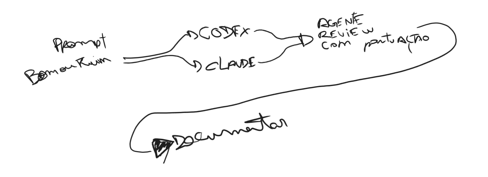

# 1 Introdução

## 1.1 Contextualização

A área de tecnologia nunca exigiu, como condição de entrada, um diploma de curso superior. Desde os primeiros anos da computação comercial, autodidatas, técnicos e pessoas vindas de outras formações entraram no mercado e nele permaneceram, e a prática continua: na pesquisa anual do Stack Overflow, menos da metade dos desenvolvedores profissionais tem bacharelado, cerca de 17% não concluíram graduação e mais de 80% dizem ter aprendido por recursos online (STACK OVERFLOW, 2024). No Brasil, o setor emprega 2,2 milhões de pessoas e o gargalo apontado pela Brasscom não é a oferta de formados, mas a passagem para o emprego formal, com mais da metade do crescimento recente vindo de trabalho autônomo e informal (BRASSCOM, 2026). Quem sabe fazer entra; o que mudou nos últimos anos é o que significa "saber fazer".

Essa mudança vem da capacidade dos modelos de linguagem de gerar código. Em pouco tempo, os modelos das principais empresas do setor passaram de completar linhas a escrever módulos inteiros com qualidade suficiente para entrar em produção. Em outubro de 2024, o Google informou que mais de um quarto do código novo da empresa era gerado por IA e revisado por engenheiros; em abril de 2025 a fração passava de 30% (ENGADGET, 2024; OFFICECHAI, 2025). No mesmo mês, a Microsoft declarou que entre 20% e 30% do código dos seus repositórios era escrito por software (TECHCRUNCH, 2025a), e a Meta previu que em pouco mais de um ano a maior parte do seu código seria escrita por IA (ENGADGET, 2025). O sinal mais eloquente talvez seja o de Linus Torvalds, criador do Linux: em janeiro de 2026 ele publicou um projeto pessoal cuja parte em Python foi, nas palavras dele, feita por vibe coding com uma ferramenta de agente, e ao longo de 2026 defendeu que o kernel aceitasse contribuições assistidas por IA, desde que declaradas e com um humano respondendo pelo código (IT'S FOSS, 2026; TOM'S HARDWARE, 2026; ADTMAG, 2026). O fato está se concretizando no mercado: cada vez menos quem coloca a mão no código é a pessoa. O profissional passa a precisar entender o produto que quer, descrever as regras, pensar a arquitetura e a infraestrutura, e saber repassar isso a quem constrói, seja um time, seja um agente.

A consequência imediata é que a barreira do código foi quebrada. Até pouco tempo, publicar um produto de software exigia alguém com experiência de mercado, e mesmo essa pessoa levava semanas ou meses, pesquisando, escrevendo, olhando e reolhando o que fez. Hoje qualquer pessoa com acesso a um agente de codificação consegue colocar um aplicativo no ar numa tarde, como este trabalho demonstra em uma de suas trilhas. A plataforma Lovable, em que o usuário descreve o produto e recebe o código e a hospedagem prontos, informou mais de 60 milhões de projetos criados em menos de dois anos, com quase 80% dos usuários construindo um negócio ou um projeto paralelo (SILICONANGLE, 2026). O termo que nomeia essa prática, vibe coding, cunhado por Andrej Karpathy em fevereiro de 2025 para um jeito de programar em que a pessoa se entrega à conversa com a IA, aceita o que ela sugere e esquece que o código existe, foi eleito palavra do ano de 2025 pelo dicionário Collins (ARS TECHNICA, 2025; CNN, 2025).

Os agentes de código e os assistentes de IA de uso geral se tornaram frequentes no dia a dia. O ChatGPT ultrapassou 700 milhões de usuários semanais em setembro de 2025, e a OpenAI mostrou, numa análise de 1,5 milhão de conversas, que cerca de 70% do uso não tem relação com trabalho: as pessoas levam à IA orientação prática, busca de informação e escrita, do mesmo modo que antes levavam ao buscador (OPENAI, 2025). Documentos, fotos, desenhos, passatempos, ideias e produtos entram na mesma caixa de texto. No Brasil, 32% dos usuários de internet, cerca de 50 milhões de pessoas, usaram IA generativa em 2025, com forte concentração nas classes e escolaridades mais altas (CETIC.BR, 2025). Entre quem programa, 84% dos respondentes do Stack Overflow em 2025 usavam ou pretendiam usar ferramentas de IA, e em 2026 73% dos que usam o fazem diariamente, com o Claude Code e o GitHub Copilot como os mais citados (SD TIMES, 2025; STACK OVERFLOW, 2026). O GitHub Copilot passou de 20 milhões de usuários acumulados em julho de 2025, com 90% das empresas da Fortune 100 (TECHCRUNCH, 2025b); o Cursor saiu de uma avaliação de US$ 29 bilhões em novembro de 2025 para uma aquisição por US$ 60 bilhões em junho de 2026; o Claude Code, da Anthropic, passou de US$ 2,5 bilhões de receita anualizada em fevereiro de 2026 (CONSTELLATION RESEARCH, 2026); e o Google lançou em novembro de 2025 o Antigravity, uma plataforma em que agentes escrevem, executam e testam código, seguido do xAI com o Grok Code. Esses produtos atendem tanto grandes empresas quanto pessoas sozinhas, e as empresas respondem com gasto: a Microsoft investiu US$ 34,9 bilhões em infraestrutura num único trimestre de 2025, e a Meta projetou entre US$ 125 e US$ 145 bilhões para 2026 (SHERWOOD NEWS, 2025; FORTUNE, 2026). Segundo a McKinsey, 88% das organizações já usam IA em ao menos uma função (MCKINSEY, 2025). Os desenvolvedores colocam cada vez menos a mão no código e trabalham cada vez mais o que dizem à IA.

## 1.2 Problema e pergunta de pesquisa

Ao lado da adoção, há um fenômeno menos visível: as pessoas usam pouco do que essas ferramentas oferecem e, com frequência, usam de forma errada, e isso é um problema sobretudo quando o que está sendo construído é um produto de software que outras pessoas vão usar com seus dados. Para verificar essa premissa, este trabalho começou com uma pesquisa anônima com 28 pessoas, em que cada uma escreveu, com as próprias palavras, como pediria a uma IA um aplicativo descrito num cenário. As mensagens de quem não desenvolve software têm em média 165 caracteres, nenhuma menciona segurança, teste, hospedagem ou publicação, e nenhuma descreve como a regra central do cenário, um sistema de pontos, deveria funcionar. Essa é a forma como a maioria das pessoas pede software a uma IA.

Do outro lado estão os profissionais que, dentro das empresas, passaram a trabalhar os prompts, os documentos de contexto e os critérios de verificação em vez do código. A mesma ferramenta está na mão de quem tem formação em engenharia de software e de quem não tem. O problema deste trabalho é que não se sabe, com evidência empírica e não com opinião, o que muda no produto entre um caso e outro. A pergunta de pesquisa é: o que muda no produto, em arquitetura, segurança, código, infraestrutura, documentação e experiência do usuário, quando a mesma ideia é construída com IA por um usuário leigo e por um engenheiro de software? A premissa que o experimento põe à prova é que o trabalho de definição (requisitos, design, arquitetura, segurança, testes, operação) não desaparece quando a IA escreve o código: ou a pessoa faz antes, ou o agente faz por ela, com os padrões dele.

## 1.3 Objetivos

O objetivo geral é comparar o produto de software construído por um mesmo agente de IA, a partir da mesma ideia, quando conduzido por um usuário leigo e por um engenheiro e arquiteto de software, nos seis eixos de uma rubrica de qualidade: experiência do usuário, segurança, infraestrutura, documentação, código e projeto e arquitetura.

Os objetivos específicos são: caracterizar como pessoas sem formação técnica pedem software a uma IA, a partir da pesquisa com 28 respondentes; construir as duas trilhas sob protocolo controlado, com o mesmo agente, o mesmo modelo, a mesma versão e a mesma validação; avaliar cada produto com a rubrica, com testes de referência independentes e com a avaliação cega do autor ao lado da de agentes revisores; medir quem fez o trabalho de definição, a pessoa ou o agente, pelo custo de entrada, pelas decisões tomadas pelo agente sem pedido e pelas regras da ideia ausentes do produto; medir o custo de cada trilha em mensagens, tempo e tokens; medir a concordância entre o revisor de IA e a validação humana; e verificar, com uma condição de prompt único, se a diferença entre as trilhas está no conteúdo do que a pessoa entrega ao agente ou na quantidade de mensagens que troca com ele.

## 1.4 Justificativa

A pergunta importa porque os agentes de codificação tornam possível, a quem não programa, publicar um aplicativo com login, fotos e dados pessoais de terceiros. Se o que separa um produto seguro e mantenível de um frágil é a disciplina de quem conduz, isso tem consequência para quem usa esses produtos, para quem ensina engenharia de software e para quem avalia código gerado por IA. Os relatórios do setor já mostram a escala do risco: 45% das amostras de código gerado por mais de cem modelos continham vulnerabilidades em 2025, e a taxa de aprovação em segurança não melhorou em 2026 enquanto os modelos ficaram mais capazes (VERACODE, 2025; 2026); milhões de segredos vazam por ano em repositórios públicos, com commits assistidos por agente vazando o dobro da média (TECHRADAR, 2026); e incidentes recentes com aplicativos construídos por quem não programa expuseram dados pessoais em escala (SEMAFOR, 2025; WIZ, 2026; TECHCRUNCH, 2026). O que falta é evidência que isole o fator humano: mesma ideia, mesmo agente, operadores diferentes.

O recorte deste trabalho, um autor, uma ideia e um agente, é a força do desenho e não a sua fraqueza: a mesma pessoa conduz as duas trilhas, e só o conhecimento aplicado muda. A tese não afirma que o engenheiro tem ideias melhores; afirma que a disciplina de engenharia de software muda o que é construído a partir da mesma ideia, e mede onde e quanto. Uma pessoa sem formação técnica pode ter a ideia melhor; o que ela não tem é a disciplina de transformá-la.

## 1.5 Escopo e delimitação

O experimento usa um agente de codificação (o Claude Code, da Anthropic), um modelo e uma versão fixados, um produto (o Maxx, rede social gamificada para a UniMax), um autor atuando nas duas personas e uma execução por condição. Não compara modelos nem ferramentas entre si, não mede produtividade de equipes e não generaliza para outros domínios além do que os registros permitem. As notas são ordinais e a comparação é descritiva, sem teste estatístico.

## 1.6 Organização do trabalho

O capítulo 2 reúne a fundamentação: modelos de linguagem, vibe coding, agentes de codificação, engenharia de requisitos, qualidade de software, engenharia de prompt e de contexto, avaliação por modelos e trabalhos relacionados. O capítulo 3 descreve o experimento: a ideia, as personas, as trilhas, o protocolo, a condição de prompt único, a validação e a rubrica. O capítulo 4 apresenta os resultados, o capítulo 5 os discute à luz da documentação do fornecedor e dos relatórios do setor, e o capítulo 6 conclui.

# 2 Fundamentação teórica

## 2.1 Inteligência artificial generativa e modelos de linguagem

Modelos de linguagem de grande escala são sistemas treinados em grandes corpora de texto, capazes de gerar, completar e transformar texto, incluindo código-fonte. Zhao et al. (2023) destacam que, apesar do desempenho em muitas tarefas, esses modelos apresentam limitações que importam diretamente para este trabalho: a geração é não determinística, o modelo não guarda memória entre sessões a não ser pelo que lhe é fornecido de novo, a coerência se degrada em contextos muito longos, e há a alucinação, a produção de conteúdo plausível e incorreto. No domínio do código, Chen et al. (2021), ao avaliar o Codex, mostraram que mesmo modelos de alto desempenho falham em cadeias longas de operações e na vinculação correta de operações a variáveis, o que exige validação sistemática do que é produzido. Essas três propriedades aparecem no desenho do experimento: o não determinismo limita a inferência a partir de uma execução por condição; a ausência de memória entre sessões é o motivo de cada rodada ser uma sessão nova com contexto controlado; e a alucinação entra como critério explícito do eixo Código e como objeto das "alegações sem lastro" do inventário.

## 2.2 Vibe coding e desenvolvimento assistido por IA

O termo vibe coding foi cunhado por Andrej Karpathy, cofundador da OpenAI, em uma publicação de fevereiro de 2025, para descrever um jeito de programar em que a pessoa descreve o que quer em linguagem natural, aceita o que o modelo sugere sem ler o código e, quando algo quebra, cola a mensagem de erro de volta; ele mesmo o recomendava para projetos descartáveis de fim de semana (ARS TECHNICA, 2025). Em novembro de 2025 o dicionário Collins o elegeu palavra do ano, definindo-o como o uso de IA guiada por linguagem natural para ajudar a escrever código (CNN, 2025). Entre o autocompletar de uma linha e o agente que recebe uma tarefa e a executa até o fim há um espectro, e a prática que este trabalho estuda está na ponta autônoma dele.

Do ponto de vista da engenharia de software, a prática desafia princípios consolidados. Pressman e Maxim (2016) e Sommerville (2018) colocam o levantamento de requisitos, o planejamento e a rastreabilidade das decisões de arquitetura na base do processo; o vibe coding é incremental e conversacional, e tende a produzir inconsistência arquitetural, dívida técnica e dificuldade de manutenção quando o projeto cresce. A questão que este trabalho faz não é se a prática funciona, e sim o que acontece com esses princípios quando quem conduz a conversa os conhece e quando não conhece.

## 2.3 Agentes de codificação

Um agente de codificação é um modelo de linguagem acoplado a ferramentas: ler e escrever arquivos, executar comandos no terminal, usar o git, buscar na web, e um laço de controle que lhe permite planejar, agir, observar o resultado e agir de novo até dar a tarefa por terminada. O Claude Code, usado neste experimento, roda no terminal do usuário com acesso à pasta de trabalho e expõe os controles que importam para o protocolo: modos de permissão, em que o agente pede aprovação antes de editar, executar ou acessar a rede, ou executa sem pedir (modo auto), ou apenas pesquisa e propõe sem alterar nada (modo plano); arquivos de instrução persistentes chamados `CLAUDE.md`, lidos no início de cada sessão a partir da pasta do projeto e das pastas acima dela; memória automática entre sessões, que pode ser desligada; e transcrições completas de cada sessão, das quais se extraem mensagens, chamadas de ferramenta, tokens e tempos (ANTHROPIC, 2026d; 2026e; 2026f). A documentação é explícita sobre dois pontos que o experimento usa: o `CLAUDE.md` é tratado pelo modelo como contexto, não como configuração imposta, e a revisão do código e dos comandos antes da aprovação é responsabilidade de quem opera (ANTHROPIC, 2026d; 2026e). Esses controles justificam as medidas do protocolo: repositórios separados por trilha, memória desligada, nenhum arquivo de instrução acima dos repositórios, e o mesmo modo de permissão nas duas trilhas.

## 2.4 Engenharia de requisitos e o trabalho de definição

Transformar uma ideia em algo construível é o que a engenharia de software chama de engenharia de requisitos: identificar atores, regras de negócio, requisitos não funcionais, casos de borda e critérios de aceite, e registrar as decisões para que possam ser rastreadas (SOMMERVILLE, 2018). É esse trabalho que separa as personas deste experimento. O engenheiro faz três definições antes do código, design, produto e técnica; o leigo entrega a ideia como a contaria num corredor. A documentação do próprio fornecedor do agente descreve a consequência: o diagnóstico mais comum de uma sessão ruim é o agente ter construído algo diferente do que o operador tinha em mente, por falta de informação que não está no repositório, e diante de um pedido vago o modelo tende a construir a menor coisa que o satisfaz (ANTHROPIC, 2026b). O trabalho de definição não desaparece quando a IA escreve o código; ou a pessoa o faz antes, ou o agente o faz por ela, e o experimento mede quanto cada agente decidiu sozinho.

## 2.5 Qualidade de software: os seis eixos

A rubrica do experimento avalia seis eixos, ancorados no modelo de qualidade de produto da ISO/IEC 25010 e, no eixo de segurança, na lista OWASP Top 10 de riscos em aplicações web (ISO/IEC, 2011; OWASP, 2021). O Quadro 1 mapeia cada eixo.

**Quadro 1. Eixos da rubrica e características de qualidade correspondentes**

| Eixo da rubrica | Característica (ISO/IEC 25010) e referência |
|---|---|
| 1. Experiência do usuário | Usabilidade: operabilidade, proteção contra erro, estética; referência funcional: especificação das seis telas |
| 2. Segurança | Segurança: confidencialidade, integridade, responsabilização; referência de vulnerabilidades: OWASP Top 10 |
| 3. Infraestrutura | Confiabilidade e eficiência de desempenho: disponibilidade, tolerância a falha, capacidade; deploy reproduzível e teste de carga |
| 4. Documentação | Manutenibilidade: analisabilidade; registro de regras, decisões e instruções de execução |
| 5. Código | Adequação funcional e manutenibilidade: correção das regras, testabilidade, modularidade; testes de referência |
| 6. Projeto e arquitetura | Manutenibilidade e portabilidade: modularidade, reusabilidade, modificabilidade; coerência com a stack escolhida |

A escala vai de 1 (crítico) a 5 (excelente) em cada eixo, com critérios escritos por nota. Uma regra importante da rubrica é a de regra ausente: quando o produto não implementa uma regra da ideia (não tem tiers, não restringe quem dá medalha), o critério é marcado como ausente, não como errado; a nota é calculada sobre o que existe, e a ausência vai para a análise como resultado, porque é exatamente o que se quer medir: a regra nunca pedida pela persona e nunca oferecida pelo agente.

## 2.6 Engenharia de prompt e de contexto

A forma e o conteúdo do pedido afetam o resultado de um agente, e o fornecedor documenta como. O guia de boas práticas da Anthropic pede que o modelo seja tratado como um funcionário brilhante e novo, sem contexto sobre as normas e os fluxos da equipe, e propõe o teste de mostrar o prompt a um colega sem contexto; recomenda explicar o porquê das instruções, ser específico sobre formato e restrições, dar exemplos, e, em sistemas agênticos, pedir confirmação antes de ações irreversíveis e preferir pesquisar e recomendar quando a intenção é ambígua (ANTHROPIC, 2026a). O guia do Claude Code acrescenta: dizer ao agente o que ele não consegue ver (decisões de reunião, processo de deploy, preferência entre duas abordagens razoáveis), escrever pedidos específicos, pedir um plano antes do código e, quando não se sabe o que especificar, pedir que o agente entreviste o usuário até conseguir escrever uma especificação; e dar ao agente algo que ele possa rodar e que volte como passa ou falha, porque sem isso quem opera é a suíte de testes (ANTHROPIC, 2026b). O trabalho da Anthropic sobre agentes confiáveis formula o mesmo em princípio: com menos supervisão há mais espaço para o agente ler mal a intenção do usuário, e ele deve pausar e perguntar quando incerto em vez de assumir (ANTHROPIC, 2026c).

Este trabalho distingue técnica de prompt de conhecimento do domínio. A técnica é aprendível em horas; o conhecimento do que perguntar (quem é professor, como se prova a posse de um e-mail, o que acontece quando o produto fica público) é o que a formação dá. Foi essa distinção que levou à decisão de os repositórios das duas trilhas nascerem vazios, sem especificação comum: com um documento de regras entregue às duas personas, o experimento mediria só técnica de prompt; sem ele, mede o fenômeno inteiro.

## 2.7 Avaliação de código por modelos de linguagem

Usar um modelo de linguagem como revisor, prática conhecida como "LLM como juiz", é barato e repetível, mas tem vieses documentados: preferência por respostas mais longas, sensibilidade à posição e ao formato, e tendência a favorecer saídas do próprio modelo ou de modelos parecidos (ZHENG et al., 2023). Por isso o experimento trata a nota do revisor de IA como rascunho e a nota do autor como a que vale, exige que os dois pontuem sem ver um ao outro, e registra a divergência como dado. IA avaliando IA sem validação humana é um dos riscos que o trabalho aponta; usá-la sem esse controle seria incoerente com a própria tese.

## 2.8 Gamificação no ensino

Gamificação é o uso de elementos de jogos, como pontos, níveis, rankings e recompensas, em contextos que não são jogos, para aumentar engajamento e motivação (DETERDING et al., 2011). No ensino superior ela aparece em sistemas de participação, de reconhecimento e de competição entre estudantes. Aqui a gamificação é o assunto do aplicativo, não o objeto da pesquisa: o Maxx premia participação em eventos e méritos em aula com prêmios de participação, medalhas dadas por professores e conquistas automáticas, cada prêmio com um tier que define pontos, e os pontos alimentam rankings por semestre e históricos, gerais e por curso. A seção serve apenas para que as regras do produto, que aparecem nos resultados, sejam compreensíveis.

## 2.9 Trabalhos relacionados

Três grupos de estudos cercam a pergunta deste trabalho sem respondê-la. O primeiro mede a segurança do código gerado por IA em laboratório: a Veracode submeteu mais de cem modelos a oitenta tarefas e encontrou vulnerabilidades em 45% das amostras em 2025 e uma taxa de aprovação estagnada em torno de 56% em 2026 (VERACODE, 2025; 2026). O segundo observa pessoas: Perry et al. (2023), em experimento controlado com 47 participantes, mostraram que quem programava com assistente de IA escreveu código menos seguro e acreditou mais que ele era seguro, e que quem desconfiava e refinava os prompts produziu menos falhas. O terceiro mede o que está em produção: a GitGuardian contou cerca de 29 milhões de segredos novos expostos no GitHub em 2025 (TECHRADAR, 2026); a Escape varreu mais de 5.600 aplicativos de plataformas de vibe coding e achou mais de 2.000 vulnerabilidades e 400 segredos (ESCAPE, 2025); e a imprensa documentou aplicativos da Lovable expondo dados por falta de regras de acesso, a rede Moltbook com milhões de registros abertos, milhares de bancos Supabase públicos e um agente da Replit apagando um banco de produção (SEMAFOR, 2025; WIZ, 2026; TECHCRUNCH, 2026; FORTUNE, 2025).

Nenhum desses estudos isola o operador. Os de laboratório não têm pessoa; o de Perry et al. compara pessoas com e sem assistente, não pessoas com formações diferentes usando o mesmo assistente; os de produção medem o resultado agregado sem saber quem pediu o quê. A lacuna que este trabalho ocupa é a comparação, sob protocolo, de duas pessoas com conhecimentos diferentes conduzindo o mesmo agente a partir da mesma ideia, com o processo inteiro registrado.

# 3 O experimento

## 3.1 Desenho

O experimento constrói o mesmo aplicativo, o Maxx, em duas trilhas independentes, a partir da mesma ideia, com o mesmo agente de codificação, o mesmo modelo, a mesma versão, os mesmos revisores e a mesma validação. O que varia é quem pede e como pede: numa trilha, os prompts são escritos como um usuário sem formação técnica escreveria; na outra, como um engenheiro e arquiteto de software escreveria. Uma terceira condição, de prompt único, repete as duas personas com uma mensagem só e nenhuma intervenção humana depois dela, o que dá uma matriz de duas personas por duas condições e quatro produtos (Figura 1).

O desenho usa um único agente e um único conjunto de revisores porque a pergunta é sobre quem conduz, não sobre qual modelo. Uma versão anterior deste trabalho previa quatro famílias de modelos com personas próprias; ela foi abandonada porque multiplicava as variáveis sem responder à pergunta.

### 3.1.1 A ideia e o conhecimento de cada persona

A ideia é a mesma nas duas trilhas e cabe num parágrafo de corredor: uma rede social para a UniMax, parecida com o Instagram mas sem stories, vídeos e mensagens, em que quem usa ganha prêmios pelo que faz e os professores dão medalhas, tudo contando para um ranking geral e um por curso, só para alunos e professores, com um mural para os avisos da faculdade. Tudo o que transforma essa ideia em algo construível é trabalho de definição, e só o engenheiro o faz antes do código.

Os repositórios das duas trilhas nascem vazios, de um mesmo commit semente com um `README` e um `.gitattributes`. Até outubro de 2026 o desenho previa entregar às duas trilhas o mesmo arquivo de regras; a decisão de retirá-lo, registrada no diário do experimento, veio de perceber que isso entregava ao leigo uma especificação que ele nunca escreveria e reduzia a medição à técnica de prompt. Sem o arquivo, a ideia entra em cada trilha pelo prompt de abertura da própria persona, e a diferença entre as trilhas começa antes da primeira linha de código.

A persona do engenheiro fez três definições antes do código. A primeira foi o design: entre agosto e setembro de 2026, rascunhos à mão e wireframes das telas, duas telas de alta fidelidade e a prancha de identidade com o logo e a paleta da instituição, depois transformados em seis telas finais em tema claro e escuro, mais a tela de cadastro e um sistema de design com tipografia, espaçamento, componentes e estados, numa ferramenta de design da Anthropic, em três sessões paralelas que exploraram direções diferentes e convergiram. A revisão do material exportado, fora da ferramenta, encontrou um defeito de navegação que passara despercebido e levou a uma correção que desfez um pedido anterior do próprio autor. A segunda definição foi o produto, e a terceira a técnica, ambas na rodada de abertura da trilha (passo 0), descrita adiante. Essas três definições custaram entre nove e dez horas de trabalho antes do primeiro prompt de código, contra zero da persona leiga; o custo entra na análise.

Também faz parte do método do engenheiro conversar antes de pedir. A ideia foi discutida com um modelo de IA antes de os prompts de abertura serem fechados, e os prompts de design e de abertura foram rascunhados com apoio de um assistente de IA e revisados contra a documentação oficial da ferramenta antes do envio. A persona leiga não faz nada disso: o corpus da pesquisa mostra que ela usa um aplicativo existente como referência ("tipo o Instagram") e pede a tela direto. O registro completo, prompt a prompt, com cada anexo e sua procedência, está no repositório do TCC.

O que a tese afirma e o que não afirma: não afirma que o engenheiro tem ideias melhores; afirma que a disciplina de engenharia de software muda o que é construído a partir da mesma ideia. O desenho com um autor único é a força do experimento: a mesma pessoa, a mesma ideia, mudando só o conhecimento aplicado. A limitação correspondente, de que um autor não consegue não saber o que sabe, é controlada pela política de reação da persona leiga, pré-registrada antes da primeira rodada.

### 3.1.2 Personas de quem escreve o prompt

A persona leiga foi construída a partir de dados, não de suposição: 28 respostas a um formulário anônimo em que cada pessoa escrevia, com as próprias palavras, a primeira mensagem que mandaria a uma IA para pedir o aplicativo de um cenário com login, mural de avisos e sistema de pontos. Dez respondentes nunca trabalharam com tecnologia, treze em função próxima (suporte, dados, design, produto, qualidade) e cinco com desenvolvimento. A linguagem de quem não desenvolve parece uma mensagem de aplicativo de conversa: aberturas informais, "app" e "site" como sinônimos, termos técnicos usados como substitutos de algo que a pessoa não sabe nomear, adjetivos de design carregando a especificação visual inteira. A primeira mensagem de quem não desenvolve tem em média 165 caracteres, contra 566 entre quem desenvolve; só 8 das 23 citam algum dos três elementos que o cenário pedia; nenhuma menciona segurança, teste, hospedagem ou publicação; e nenhuma descreve como os pontos funcionariam, embora "sistema de pontos" fosse um dos três itens. Quando há estrutura, ela aparece como pedir por partes, uma tela de cada vez, ou mandar uma referência visual em vez de descrever. Entre as suposições comuns estão a de que a IA vai perguntar o que falta e a de que a tecnologia por trás é um detalhe que a IA resolve. Perguntadas diretamente como saberiam que o aplicativo funciona, 78% disseram que pediriam a outras pessoas que testassem antes de lançar: a preocupação existe, mas mora na fase de validação declarada, não na primeira mensagem.

A amostra é de conveniência, vinda das redes do autor, provavelmente mais jovem, mais escolarizada e mais familiarizada com IA do que o público leigo médio; duas respostas de não desenvolvedores com vocabulário técnico foram tratadas como contaminação e uma como ruído. O corpus descreve o leigo tecnicamente inexperiente mas já habituado a conversar com IA, não o que nunca abriu um chat.

A persona do engenheiro é o próprio autor, engenheiro e arquiteto de software com quase sete anos de carreira em sistemas de grande porte, corroborado pelas respostas dos desenvolvedores do corpus. O Quadro 2 compara as duas.

**Quadro 2. As duas personas**

| Dimensão | Leigo | Engenheiro |
|---|---|---|
| Vocabulário | Nome comum da tela ("tela de entrar", "mural"); referência a app existente | Atores, regras, requisitos não funcionais, critérios de aceite |
| Tamanho do pedido | Uma frase a um parágrafo (abertura com 481 caracteres) | Páginas de produto e técnica, mais um plano por passo |
| Ordem de trabalho | Pede a tela direto, na ordem da especificação | Design, produto e técnica antes do código; plano de etapas antes de cada passo |
| Resposta a perguntas do agente | "Faz do jeito que ficar melhor"; escolhe a opção mais simples | Responde com a restrição técnica; pede opções com pesos; nunca decide fora dos documentos |
| Validação | Usa o produto e reclama do que vê quebrado ou feio | Revisão por etapa, capturas contra pranchetas, testes, CI, testes de referência |
| Regra de ouro | Nenhuma | O agente não assume: decisão que não está nos documentos não foi tomada |

A política de reação do leigo, pré-registrada: pede a tela pelo nome comum, na ordem da especificação, sem regra de negócio além da abertura; aceita o que o agente propõe (stack, estrutura, regra de pontos, hospedagem); reclama só do que vê quebrado ou feio ao usar, nas palavras do corpus; e não introduz regra de produto nova, mesmo que o autor a conheça. A abertura e os pedidos de tela foram escritos antes da primeira rodada e não mudaram depois de nenhum resultado, com uma exceção declarada (o pedido de publicação, ajustado antes do envio por pressupor um teste que não houve, registrado com o diff e o motivo).

### 3.1.3 Trilhas, rodadas e protocolo de execução

Cada trilha é um repositório próprio, `maxx-leigo` e `maxx-engenheiro`, nascidos da mesma semente vazia; são dois repositórios, e não duas branches de um só, porque o agente executa `git` e poderia ler a outra trilha. Cada rodada é uma sessão nova do agente, aberta na pasta do repositório da trilha, numa branch da rodada, sem orquestrador entre a persona e o agente: o único texto que chega ao agente é o da persona. O prompt de cada rodada é salvo num arquivo antes do envio e vai ao agente idêntico ao arquivo; qualquer ajuste é uma rodada nova com sufixo. Perguntas do agente são respondidas no estilo da persona e nunca com decisão de produto que não esteja na abertura. Quando o agente termina, nada é corrigido na trilha do leigo; na do engenheiro, a correção faz parte da persona e tem o custo registrado. Cada sessão é exportada em texto e a transcrição completa é copiada, e é dela que saem mensagens, chamadas de ferramenta, tokens e tempos. Por rodada fica um registro com o resumo, as decisões que o agente tomou sem o prompt pedir, as perguntas e respostas, os turnos humanos e o tempo, e o merge na `main` da trilha.

Na trilha do leigo são oito rodadas: a abertura e sete pedidos (entrar e cadastrar com o acesso da banca, feed, perfil, mural, troféus, ranking e publicação). Na trilha do engenheiro, a rodada de abertura (passo 0) produziu, em cinco dias de discussão com o agente, o documento de produto, o registro de decisões técnicas, o plano mestre de treze passos e o `CLAUDE.md` do repositório; cada passo seguinte é uma rodada, aberta por um prompt que relembra o que fecha o passo e pede um plano de etapas com entrega e critério de aceite antes de qualquer código. O `CLAUDE.md` fixa o protocolo de trabalho que o agente segue em toda sessão: ler os documentos antes de agir, nenhum código antes do plano aprovado, revisão humana de cada etapa antes do commit, um commit por etapa e um PR por passo, e a regra que a persona considera primordial, escrita nas palavras do próprio arquivo: "Decisão que não está nesses arquivos não foi tomada. Pergunte, não assuma." A partir do passo 3 a persona acrescentou a exigência de integração contínua verde em cada etapa, com falha de CI corrigida em commit separado.

O ambiente é o mesmo nas duas trilhas e foi conferido no início de cada sessão: a mesma interface de linha de comando, o mesmo modelo da família Opus da Anthropic escolhido por nome, o mesmo nível de esforço, o modo de permissão auto (o agente executa sem pedir aprovação a cada ação), memória automática desligada, nenhum arquivo de instrução no usuário nem nas pastas acima dos repositórios, e as mesmas habilidades e conectores visíveis ao agente, nenhum relacionado ao projeto. O Quadro 3 registra os identificadores. Duas mudanças fora do controle do autor ocorreram na rodada de abertura do engenheiro, que é só documentação: a atualização automática da interface e a troca silenciosa de modelo e esforço por baixo da opção escolhida; a partir daí a versão, o modelo e o esforço foram fixados, conferidos antes de cada sessão e confirmados na transcrição ao fim de cada uma, e a atualização automática foi desligada. A trilha do leigo inteira e os passos 1 a 13 do engenheiro rodaram no ambiente fixo.

**Quadro 3. Ambiente das rodadas**

| Item | Valor |
|---|---|
| Interface | Claude Code (CLI) 2.1.308, depois 2.1.316 a partir do passo 3 do engenheiro, no Windows |
| Modelo e esforço | `claude-opus-5-5`, esforço `medium`, conferidos por `/model` antes do primeiro prompt e no `.jsonl` ao fim |
| Modo de permissão | Auto |
| Memória automática | Desligada (`CLAUDE_CODE_DISABLE_AUTO_MEMORY=1`) |
| Arquivos de instrução | Nenhum fora do repositório da trilha; no engenheiro, o `CLAUDE.md` que a própria trilha criou no passo 0 |
| Isolamento | Um repositório por trilha, mesma semente; o agente nunca acessa a outra trilha (conferido no export de cada rodada) |

### 3.1.4 Condição de prompt único

As duas trilhas são iterativas e isso deixa uma explicação concorrente para qualquer diferença entre os produtos: o engenheiro poderia chegar a um produto melhor não pelo que sabe, mas porque fala mais com o agente. A condição de prompt único separa as duas coisas. Cada persona entrega ao agente, numa única mensagem, tudo o que entrega na abertura da trilha iterativa; depois disso nenhuma mensagem humana entra na sessão, e o agente vai até onde consegue sozinho, num repositório novo, vazio e sem remoto, com o mesmo ambiente.

As hipóteses e a regra de decisão foram fixadas num pré-registro commitado antes da primeira execução. H1: com uma mensagem só em cada persona, o produto do engenheiro recebe nota maior que o do leigo nos cinco eixos técnicos, apoiada se a diferença for de pelo menos um ponto, no sentido previsto, em ao menos quatro dos cinco. H2: o prompt único do engenheiro não fica abaixo do produto final da trilha iterativa do leigo nesses eixos, apoiada se em nenhum eixo ficar um ponto ou mais abaixo. H3: o agente toma mais decisões sem perguntar no prompt único do leigo do que no do engenheiro, e a diferença é maior que entre as trilhas iterativas. Com uma execução por condição e escala ordinal, a leitura é descritiva. O pré-registro fixa também o isolamento, a política de aprovação, o critério de parada, o inventário de cobertura e as métricas; qualquer mudança posterior vira condição declarada ao lado da original, e três foram declaradas: o momento da execução, a ordem entre as personas e o modo de avaliação dos produtos dessa condição, em que o autor valida as notas do revisor em vez de pontuar às cegas, porque o foco ali é o quanto o agente faz sozinho. [A PREENCHER: execução do `eng_pu` e validação do `leigo_pu`.]

## 3.2 Validação do código gerado

Dois instrumentos independentes do agente validam cada produto. A suíte de testes de referência é uma bateria de caixa preta, por HTTP, com um adaptador por produto, que cobre as fronteiras da regra de pontos que o produto tiver (no engenheiro, os tiers em 30/31, 70/71, 100/101 e 150/151; no leigo, as metas das conquistas e o valor de cada ação), entradas inválidas e a ordenação do ranking; quando o produto não tem a regra, o caso é "ausente". Ela foi executada contra o produto do leigo com 51 casos e seu resultado entra no eixo Código. O teste de carga, com k6 a 2.000 usuários virtuais e p95 medido em feed, perfil, ranking e mural, faz parte do último passo da trilha do engenheiro e se aplica ao produto publicado; o produto do leigo não tem relatório de carga, o que a rubrica registra. [A PREENCHER: resultado dos testes de referência no engenheiro e do teste de carga.]

## 3.3 Rubrica, revisores e avaliação do autor

A rubrica tem seis eixos (experiência do usuário, segurança, infraestrutura, documentação, código, projeto e arquitetura), escala de 1 a 5 com critérios escritos por nota, e a regra de regra ausente. É aplicada uma vez por produto, sobre o estado final do repositório, em duas camadas independentes. A primeira são seis sessões não interativas do mesmo agente, uma por eixo, abertas por um script sobre um checkout limpo do commit avaliado, liberado só para leitura e sem acesso ao review dos outros eixos; o revisor lê e não executa, e um ensaio com um `CLAUDE.md` isca provou que o arquivo do produto é lido como artefato e não como instrução. Cada review traz nota, justificativa, evidências com arquivo e linha, falhas reproduzíveis, regras ausentes, decisões do agente dentro do eixo e o que não pôde ser verificado. A segunda camada é o autor, que preenche um formulário com as seis notas e observações objetivas antes de abrir qualquer review, commita o formulário, e só então lê os reviews; onde a divergência é de dois pontos ou mais, escreve uma linha explicando, sem alterar a nota cega. A divergência é resultado. Um sétimo revisor lê os exports das sessões e lista as decisões que o agente tomou sem perguntar e as perguntas que fez, como insumo; a contagem que vale é a do autor, feita a partir dos exports e dos diffs, por tipo (regra de produto, stack e arquitetura, modelo de dados, segurança, UX e visual, testes e processo, hospedagem e deploy) e por forma (declarada no relatório do agente ou silenciosa, visível só no que foi feito).

Completam a avaliação o inventário de cobertura, uma lista fixa de quinze itens da ideia, igual para os quatro produtos, em que cada item é marcado como funcionando, parcial, quebrado, simulado ou ausente, preenchido pelo autor usando o produto; as alegações sem lastro, o que a mensagem final do agente diz que está pronto e o inventário mostra que não está; e as medidas de custo por rodada, extraídas das transcrições: mensagens de conteúdo do autor, mensagens e chamadas de ferramenta do agente, tokens de entrada, saída e cache, tempo de relógio e de atividade, commits e compactações de contexto.

## 3.4 Aspectos éticos e registro

A pesquisa com os 28 respondentes foi anônima e as respostas foram catalogadas sem identificação. Nenhum dado real de aluno entra nos produtos: os dois usam dados de demonstração, e o do engenheiro usa um domínio de e-mail reservado para as contas fictícias. As credenciais de infraestrutura nunca passam pelo chat do agente. Tudo o que o experimento produziu está num repositório público: prompts e respostas, exports e transcrições, registros por rodada, reviews, formulários do autor, inventários, diário e linha do tempo com cada alteração de protocolo e cada ocorrência externa, de modo que outra pessoa possa repetir o desenho ou auditar as conclusões.
