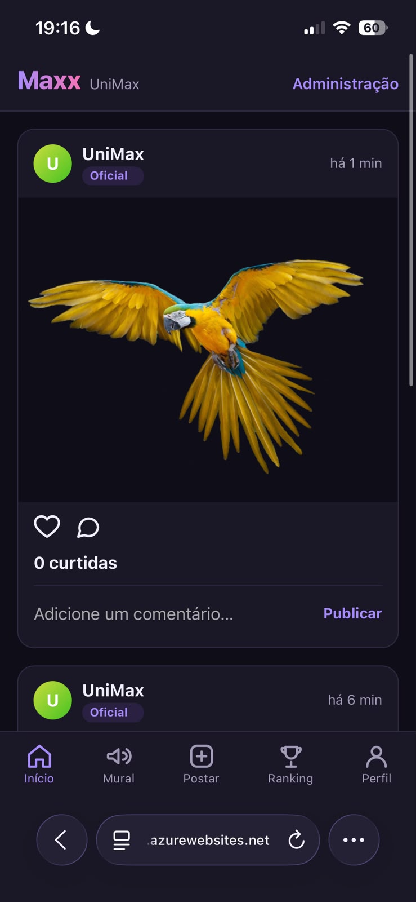

# 1 Introdução

## 1.1 Contextualização

A área de tecnologia nunca exigiu, como condição de entrada, um diploma de curso superior. Desde os primeiros anos da computação comercial, autodidatas, técnicos e pessoas vindas de outras formações entraram no mercado e nele permaneceram, e a prática continua: na pesquisa anual do Stack Overflow, menos da metade dos desenvolvedores profissionais tem bacharelado, cerca de 17% não concluíram graduação e mais de 80% dizem ter aprendido por recursos online (STACK OVERFLOW, 2024). No Brasil, o setor emprega 2,2 milhões de pessoas e o gargalo apontado pela Brasscom não é a oferta de formados, mas a passagem para o emprego formal, com mais da metade do crescimento recente vindo de trabalho autônomo e informal (BRASSCOM, 2026). Quem sabe fazer entra; o que mudou nos últimos anos é o que significa "saber fazer".

Essa mudança vem da capacidade dos modelos de linguagem de gerar código. Em outubro de 2024, o Google informou que mais de um quarto do código novo da empresa era gerado por IA e revisado por engenheiros, fração que passava de 30% em abril de 2025 (ENGADGET, 2024; OFFICECHAI, 2025); no mesmo mês, a Microsoft declarou que entre 20% e 30% do código dos seus repositórios era escrito por software (TECHCRUNCH, 2025a). O sinal mais eloquente talvez seja o de Linus Torvalds, criador do Linux: em janeiro de 2026 ele publicou um projeto pessoal cuja parte em Python foi, nas palavras dele, feita por vibe coding com uma ferramenta de agente, e ao longo de 2026 defendeu que o kernel aceitasse contribuições assistidas por IA, desde que declaradas e com um humano respondendo pelo código (IT'S FOSS, 2026; TOM'S HARDWARE, 2026). Cada vez menos quem coloca a mão no código é a pessoa; o profissional passa a precisar entender o produto que quer, descrever as regras, pensar a arquitetura e a infraestrutura, e saber repassar isso a quem constrói, seja um time, seja um agente.

A consequência imediata é que a barreira do código foi quebrada. Até pouco tempo, publicar um produto de software exigia alguém com experiência de mercado, e mesmo essa pessoa levava semanas ou meses, pesquisando, escrevendo, olhando e reolhando o que fez. Hoje qualquer pessoa com acesso a um agente de codificação consegue colocar um aplicativo no ar numa tarde, como este trabalho demonstra em uma de suas trilhas. A plataforma Lovable, em que o usuário descreve o produto e recebe o código e a hospedagem prontos, informou mais de 60 milhões de projetos criados em menos de dois anos, com quase 80% dos usuários construindo um negócio ou um projeto paralelo (SILICONANGLE, 2026). O termo que nomeia essa prática, vibe coding, cunhado por Andrej Karpathy em fevereiro de 2025 para um jeito de programar em que a pessoa se entrega à conversa com a IA, aceita o que ela sugere e esquece que o código existe, foi eleito palavra do ano de 2025 pelo dicionário Collins (ARS TECHNICA, 2025; CNN, 2025).

Os agentes de código e os assistentes de IA de uso geral se tornaram frequentes no dia a dia. O ChatGPT ultrapassou 700 milhões de usuários semanais em 2025, e cerca de 70% do uso não tem relação com trabalho: as pessoas levam à IA orientação prática, busca de informação e escrita, do mesmo modo que antes levavam ao buscador (OPENAI, 2025). No Brasil, 32% dos usuários de internet, cerca de 50 milhões de pessoas, usaram IA generativa em 2025 (CETIC.BR, 2025). Entre quem programa, 84% dos respondentes do Stack Overflow em 2025 usavam ou pretendiam usar ferramentas de IA, e em 2026 73% dos que usam o fazem diariamente, com o Claude Code e o GitHub Copilot como os mais citados (SD TIMES, 2025; STACK OVERFLOW, 2026); o Copilot passou de 20 milhões de usuários e o Claude Code de US$ 2,5 bilhões de receita anualizada (TECHCRUNCH, 2025b; CONSTELLATION RESEARCH, 2026). As empresas respondem com gasto: a Microsoft investiu US$ 34,9 bilhões em infraestrutura num único trimestre de 2025 (SHERWOOD NEWS, 2025), e 88% das organizações já usam IA em ao menos uma função (MCKINSEY, 2025). Os desenvolvedores colocam cada vez menos a mão no código e trabalham cada vez mais o que dizem à IA.

## 1.2 Problema e pergunta de pesquisa

Ao lado da adoção, há um fenômeno menos visível: as pessoas usam pouco do que essas ferramentas oferecem e, com frequência, usam de forma errada, e isso é um problema sobretudo quando o que está sendo construído é um produto de software que outras pessoas vão usar com seus dados. Para verificar essa premissa, este trabalho começou com uma pesquisa anônima com 28 pessoas, em que cada uma escreveu, com as próprias palavras, como pediria a uma IA um aplicativo descrito num cenário. As mensagens de quem não desenvolve software têm em média 165 caracteres, nenhuma menciona segurança, teste, hospedagem ou publicação, e nenhuma descreve como a regra central do cenário, um sistema de pontos, deveria funcionar. Essa é a forma como a maioria das pessoas pede software a uma IA.

Do outro lado estão os profissionais que, dentro das empresas, passaram a trabalhar os prompts, os documentos de contexto e os critérios de verificação em vez do código. A mesma ferramenta está na mão de quem tem formação em engenharia de software e de quem não tem. O problema deste trabalho é que não se sabe, com evidência empírica e não com opinião, o que muda no produto entre um caso e outro. A pergunta de pesquisa é: o que muda no produto, em arquitetura, segurança, código, infraestrutura, documentação e experiência do usuário, quando a mesma ideia é construída com IA por um usuário leigo e por um engenheiro de software? A premissa que o experimento põe à prova é que o trabalho de definição (requisitos, design, arquitetura, segurança, testes, operação) não desaparece quando a IA escreve o código: ou a pessoa faz antes, ou o agente faz por ela, com os padrões dele.

## 1.3 Objetivos

O objetivo geral é comparar o produto de software construído por um mesmo agente de IA, a partir da mesma ideia, quando conduzido por um usuário leigo e por um engenheiro e arquiteto de software, nos seis eixos de uma rubrica de qualidade: experiência do usuário, segurança, infraestrutura, documentação, código e projeto e arquitetura.

Os objetivos específicos são: caracterizar como pessoas sem formação técnica pedem software a uma IA, a partir da pesquisa com 28 respondentes; construir as duas trilhas sob protocolo controlado, com o mesmo agente, o mesmo modelo, a mesma versão e a mesma validação; avaliar cada produto com a rubrica, com testes de referência independentes e com a avaliação cega do autor ao lado da de agentes revisores; medir quem fez o trabalho de definição, a pessoa ou o agente, pelo custo de entrada, pelas decisões tomadas pelo agente sem pedido e pelas regras da ideia ausentes do produto; medir o custo de cada trilha em mensagens, tempo e tokens; medir a concordância entre o revisor de IA e a validação humana; e verificar, com uma condição de prompt único, se a diferença entre as trilhas está no conteúdo do que a pessoa entrega ao agente ou na quantidade de mensagens que troca com ele.

## 1.4 Justificativa

A pergunta importa porque os agentes de codificação tornam possível, a quem não programa, publicar um aplicativo com login, fotos e dados pessoais de terceiros. Se o que separa um produto seguro e mantenível de um frágil é a disciplina de quem conduz, isso tem consequência para quem usa esses produtos, para quem ensina engenharia de software e para quem avalia código gerado por IA. Os relatórios do setor já mostram a escala do risco: 45% das amostras de código gerado por mais de cem modelos continham vulnerabilidades em 2025, e a taxa de aprovação em segurança não melhorou em 2026 enquanto os modelos ficaram mais capazes (VERACODE, 2025; 2026); milhões de segredos vazam por ano em repositórios públicos, com commits assistidos por agente vazando o dobro da média (TECHRADAR, 2026); e incidentes recentes com aplicativos construídos por quem não programa expuseram dados pessoais em escala (SEMAFOR, 2025; WIZ, 2026; TECHCRUNCH, 2026). O que falta é evidência que isole o fator humano: mesma ideia, mesmo agente, operadores diferentes.

O recorte deste trabalho, um autor, uma ideia e um agente, é a força do desenho e não a sua fraqueza: a mesma pessoa conduz as duas trilhas, e só o conhecimento aplicado muda. A tese não afirma que o engenheiro tem ideias melhores; afirma que a disciplina de engenharia de software muda o que é construído a partir da mesma ideia, e mede onde e quanto. Uma pessoa sem formação técnica pode ter a ideia melhor; o que ela não tem é a disciplina de transformá-la.

## 1.5 Escopo e delimitação

O experimento usa um agente de codificação (o Claude Code, da Anthropic), um modelo e uma versão fixados, um produto (o Maxx, rede social gamificada para a UniMax), um autor atuando nas duas personas e uma execução por condição. Não compara modelos nem ferramentas entre si, não mede produtividade de equipes e não generaliza para outros domínios além do que os registros permitem. As notas são ordinais e a comparação é descritiva, sem teste estatístico.

# 2 Fundamentação teórica

## 2.1 Inteligência artificial generativa e modelos de linguagem

Modelos de linguagem de grande escala são sistemas treinados em grandes corpora de texto, capazes de gerar, completar e transformar texto, incluindo código-fonte. Zhao et al. (2023) destacam que, apesar do desempenho em muitas tarefas, esses modelos apresentam limitações que importam diretamente para este trabalho: a geração é não determinística, o modelo não guarda memória entre sessões a não ser pelo que lhe é fornecido de novo, a coerência se degrada em contextos muito longos, e há a alucinação, a produção de conteúdo plausível e incorreto. No domínio do código, Chen et al. (2021), ao avaliar o Codex, mostraram que mesmo modelos de alto desempenho falham em cadeias longas de operações e na vinculação correta de operações a variáveis, o que exige validação sistemática do que é produzido. Essas três propriedades aparecem no desenho do experimento: o não determinismo limita a inferência a partir de uma execução por condição; a ausência de memória entre sessões é o motivo de cada rodada ser uma sessão nova com contexto controlado; e a alucinação entra como critério explícito do eixo Código e como objeto das "alegações sem lastro" do inventário.

## 2.2 Vibe coding e desenvolvimento assistido por IA

O termo vibe coding foi cunhado por Andrej Karpathy, cofundador da OpenAI, em uma publicação de fevereiro de 2025, para descrever um jeito de programar em que a pessoa descreve o que quer em linguagem natural, aceita o que o modelo sugere sem ler o código e, quando algo quebra, cola a mensagem de erro de volta; ele mesmo o recomendava para projetos descartáveis de fim de semana (ARS TECHNICA, 2025). Em novembro de 2025 o dicionário Collins o elegeu palavra do ano, definindo-o como o uso de IA guiada por linguagem natural para ajudar a escrever código (CNN, 2025). Entre o autocompletar de uma linha e o agente que recebe uma tarefa e a executa até o fim há um espectro, e a prática que este trabalho estuda está na ponta autônoma dele.

Do ponto de vista da engenharia de software, a prática desafia princípios consolidados. Pressman e Maxim (2016) e Sommerville (2018) colocam o levantamento de requisitos, o planejamento e a rastreabilidade das decisões de arquitetura na base do processo; o vibe coding é incremental e conversacional, e tende a produzir inconsistência arquitetural, dívida técnica e dificuldade de manutenção quando o projeto cresce. A questão que este trabalho faz não é se a prática funciona, e sim o que acontece com esses princípios quando quem conduz a conversa os conhece e quando não conhece.

## 2.3 Agentes de codificação

Um agente de codificação é um modelo de linguagem acoplado a ferramentas: ler e escrever arquivos, executar comandos no terminal, usar o git, buscar na web, e um laço de controle que lhe permite planejar, agir, observar o resultado e agir de novo até dar a tarefa por terminada. O Claude Code, usado neste experimento, roda no terminal do usuário com acesso à pasta de trabalho e expõe os controles que importam para o protocolo: modos de permissão, em que o agente pede aprovação antes de editar, executar ou acessar a rede, ou executa sem pedir (modo auto), ou apenas pesquisa e propõe sem alterar nada (modo plano); arquivos de instrução persistentes chamados `CLAUDE.md`, lidos no início de cada sessão a partir da pasta do projeto e das pastas acima dela; memória automática entre sessões, que pode ser desligada; e transcrições completas de cada sessão, das quais se extraem mensagens, chamadas de ferramenta, tokens e tempos (ANTHROPIC, 2026d; 2026e; 2026f). A documentação é explícita sobre dois pontos que o experimento usa: o `CLAUDE.md` é tratado pelo modelo como contexto, não como configuração imposta, e a revisão do código e dos comandos antes da aprovação é responsabilidade de quem opera (ANTHROPIC, 2026d; 2026e). Esses controles justificam as medidas do protocolo: repositórios separados por trilha, memória desligada, nenhum arquivo de instrução acima dos repositórios, e o mesmo modo de permissão nas duas trilhas.

## 2.4 Engenharia de requisitos e o trabalho de definição

Transformar uma ideia em algo construível é o que a engenharia de software chama de engenharia de requisitos: identificar atores, regras de negócio, requisitos não funcionais, casos de borda e critérios de aceite, e registrar as decisões para que possam ser rastreadas (SOMMERVILLE, 2018). É esse trabalho que separa as personas deste experimento. O engenheiro faz três definições antes do código, design, produto e técnica; o leigo entrega a ideia como a contaria num corredor. A documentação do próprio fornecedor do agente descreve a consequência: o diagnóstico mais comum de uma sessão ruim é o agente ter construído algo diferente do que o operador tinha em mente, por falta de informação que não está no repositório, e diante de um pedido vago o modelo tende a construir a menor coisa que o satisfaz (ANTHROPIC, 2026b). O trabalho de definição não desaparece quando a IA escreve o código; ou a pessoa o faz antes, ou o agente o faz por ela, e o experimento mede quanto cada agente decidiu sozinho.

## 2.5 Qualidade de software: os seis eixos

A rubrica do experimento avalia seis eixos, ancorados no modelo de qualidade de produto da ISO/IEC 25010 e, no eixo de segurança, na lista OWASP Top 10 de riscos em aplicações web (ISO/IEC, 2011; OWASP, 2021). O Quadro 1 mapeia cada eixo.

**Quadro 1. Eixos da rubrica e características de qualidade correspondentes**

| Eixo da rubrica | Característica (ISO/IEC 25010) e referência |
|---|---|
| 1. Experiência do usuário | Usabilidade: operabilidade, proteção contra erro, estética; referência funcional: especificação das seis telas |
| 2. Segurança | Segurança: confidencialidade, integridade, responsabilização; referência de vulnerabilidades: OWASP Top 10 |
| 3. Infraestrutura | Confiabilidade e eficiência de desempenho: disponibilidade, tolerância a falha, capacidade; deploy reproduzível e teste de carga |
| 4. Documentação | Manutenibilidade: analisabilidade; registro de regras, decisões e instruções de execução |
| 5. Código | Adequação funcional e manutenibilidade: correção das regras, testabilidade, modularidade; testes de referência |
| 6. Projeto e arquitetura | Manutenibilidade e portabilidade: modularidade, reusabilidade, modificabilidade; coerência com a stack escolhida |

A escala vai de 1 (crítico) a 5 (excelente) em cada eixo, com critérios escritos por nota. Uma regra importante da rubrica é a de regra ausente: quando o produto não implementa uma regra da ideia (não tem tiers, não restringe quem dá medalha), o critério é marcado como ausente, não como errado; a nota é calculada sobre o que existe, e a ausência vai para a análise como resultado, porque é exatamente o que se quer medir: a regra nunca pedida pela persona e nunca oferecida pelo agente.

## 2.6 Engenharia de prompt e de contexto

A forma e o conteúdo do pedido afetam o resultado de um agente, e o fornecedor documenta como. O guia de boas práticas da Anthropic pede que o modelo seja tratado como um funcionário brilhante e novo, sem contexto sobre as normas e os fluxos da equipe, e propõe o teste de mostrar o prompt a um colega sem contexto; recomenda explicar o porquê das instruções, ser específico sobre formato e restrições, dar exemplos, e, em sistemas agênticos, pedir confirmação antes de ações irreversíveis e preferir pesquisar e recomendar quando a intenção é ambígua (ANTHROPIC, 2026a). O guia do Claude Code acrescenta: dizer ao agente o que ele não consegue ver (decisões de reunião, processo de deploy, preferência entre duas abordagens razoáveis), escrever pedidos específicos, pedir um plano antes do código e, quando não se sabe o que especificar, pedir que o agente entreviste o usuário até conseguir escrever uma especificação; e dar ao agente algo que ele possa rodar e que volte como passa ou falha, porque sem isso quem opera é a suíte de testes (ANTHROPIC, 2026b). O trabalho da Anthropic sobre agentes confiáveis formula o mesmo em princípio: com menos supervisão há mais espaço para o agente ler mal a intenção do usuário, e ele deve pausar e perguntar quando incerto em vez de assumir (ANTHROPIC, 2026c).

Este trabalho distingue técnica de prompt de conhecimento do domínio. A técnica é aprendível em horas; o conhecimento do que perguntar (quem é professor, como se prova a posse de um e-mail, o que acontece quando o produto fica público) é o que a formação dá. Foi essa distinção que levou à decisão de os repositórios das duas trilhas nascerem vazios, sem especificação comum: com um documento de regras entregue às duas personas, o experimento mediria só técnica de prompt; sem ele, mede o fenômeno inteiro.

## 2.7 Avaliação de código por modelos de linguagem

Usar um modelo de linguagem como revisor, prática conhecida como "LLM como juiz", é barato e repetível, mas tem vieses documentados: preferência por respostas mais longas, sensibilidade à posição e ao formato, e tendência a favorecer saídas do próprio modelo ou de modelos parecidos (ZHENG et al., 2023). Por isso o experimento trata a nota do revisor de IA como rascunho e a nota do autor como a que vale, exige que os dois pontuem sem ver um ao outro, e registra a divergência como dado. IA avaliando IA sem validação humana é um dos riscos que o trabalho aponta; usá-la sem esse controle seria incoerente com a própria tese.

## 2.8 Gamificação no ensino

Gamificação é o uso de elementos de jogos, como pontos, níveis, rankings e recompensas, em contextos que não são jogos, para aumentar engajamento e motivação (DETERDING et al., 2011). Aqui ela é o assunto do aplicativo, não o objeto da pesquisa: o Maxx premia participação em eventos e méritos em aula com prêmios de participação, medalhas dadas por professores e conquistas automáticas, cada prêmio com um tier que define pontos, e os pontos alimentam rankings por semestre e históricos, gerais e por curso.

## 2.9 Trabalhos relacionados

Três grupos de estudos cercam a pergunta deste trabalho sem respondê-la. O primeiro mede a segurança do código gerado por IA em laboratório: a Veracode submeteu mais de cem modelos a oitenta tarefas e encontrou vulnerabilidades em 45% das amostras em 2025 e uma taxa de aprovação estagnada em torno de 56% em 2026 (VERACODE, 2025; 2026). O segundo observa pessoas: Perry et al. (2023), em experimento controlado com 47 participantes, mostraram que quem programava com assistente de IA escreveu código menos seguro e acreditou mais que ele era seguro, e que quem desconfiava e refinava os prompts produziu menos falhas. O terceiro mede o que está em produção: a GitGuardian contou cerca de 29 milhões de segredos novos expostos no GitHub em 2025 (TECHRADAR, 2026); a Escape varreu mais de 5.600 aplicativos de plataformas de vibe coding e achou mais de 2.000 vulnerabilidades e 400 segredos (ESCAPE, 2025); e a imprensa documentou aplicativos da Lovable expondo dados por falta de regras de acesso, a rede Moltbook com milhões de registros abertos, milhares de bancos Supabase públicos e um agente da Replit apagando um banco de produção (SEMAFOR, 2025; WIZ, 2026; TECHCRUNCH, 2026; FORTUNE, 2025).

Nenhum desses estudos isola o operador. Os de laboratório não têm pessoa; o de Perry et al. compara pessoas com e sem assistente, não pessoas com formações diferentes usando o mesmo assistente; os de produção medem o resultado agregado sem saber quem pediu o quê. A lacuna que este trabalho ocupa é a comparação, sob protocolo, de duas pessoas com conhecimentos diferentes conduzindo o mesmo agente a partir da mesma ideia, com o processo inteiro registrado.

# 3 O experimento

## 3.1 Desenho

O experimento constrói o mesmo aplicativo, o Maxx, em duas trilhas independentes, a partir da mesma ideia, com o mesmo agente de codificação, o mesmo modelo, a mesma versão, os mesmos revisores e a mesma validação. O que varia é quem pede e como pede: numa trilha, os prompts são escritos como um usuário sem formação técnica escreveria; na outra, como um engenheiro e arquiteto de software escreveria. Uma terceira condição, de prompt único, repete as duas personas com uma mensagem só e nenhuma intervenção humana depois dela, o que dá uma matriz de duas personas por duas condições e quatro produtos.

O desenho usa um único agente e um único conjunto de revisores porque a pergunta é sobre quem conduz, não sobre qual modelo.

### 3.1.1 A ideia e o conhecimento de cada persona

A ideia é a mesma nas duas trilhas e cabe num parágrafo de corredor: uma rede social para a UniMax, parecida com o Instagram mas sem stories, vídeos e mensagens, em que quem usa ganha prêmios pelo que faz e os professores dão medalhas, tudo contando para um ranking geral e um por curso, só para alunos e professores, com um mural para os avisos da faculdade. Tudo o que transforma essa ideia em algo construível é trabalho de definição, e só o engenheiro o faz antes do código.

Os repositórios das duas trilhas nascem vazios, de um mesmo commit semente com um `README` e um `.gitattributes`. Até outubro de 2026 o desenho previa entregar às duas trilhas o mesmo arquivo de regras; a decisão de retirá-lo, registrada no diário do experimento, veio de perceber que isso entregava ao leigo uma especificação que ele nunca escreveria e reduzia a medição à técnica de prompt. Sem o arquivo, a ideia entra em cada trilha pelo prompt de abertura da própria persona, e a diferença entre as trilhas começa antes da primeira linha de código.

A persona do engenheiro fez três definições antes do código. A primeira foi o design: entre agosto e setembro de 2026, rascunhos à mão, wireframes, duas telas de alta fidelidade e a prancha de identidade, depois transformados em seis telas finais em tema claro e escuro e um sistema de design (tipografia, espaçamento, componentes, estados) numa ferramenta de design da Anthropic, em três sessões paralelas que exploraram direções diferentes e convergiram; a revisão do material exportado encontrou um defeito de navegação que passara despercebido e levou a uma correção. A segunda definição foi o produto, e a terceira a técnica, ambas na rodada de abertura da trilha. As três custaram entre nove e dez horas de trabalho antes do primeiro prompt de código, contra zero da persona leiga.

Também faz parte do método do engenheiro conversar antes de pedir. A ideia foi discutida com um modelo de IA antes de os prompts de abertura serem fechados, e os prompts de design e de abertura foram rascunhados com apoio de um assistente de IA e revisados contra a documentação oficial da ferramenta antes do envio. A persona leiga não faz nada disso: o corpus da pesquisa mostra que ela usa um aplicativo existente como referência ("tipo o Instagram") e pede a tela direto. O registro completo, prompt a prompt, com cada anexo e sua procedência, está no repositório do TCC.

O que a tese afirma e o que não afirma: não afirma que o engenheiro tem ideias melhores; afirma que a disciplina de engenharia de software muda o que é construído a partir da mesma ideia. O desenho com um autor único é a força do experimento: a mesma pessoa, a mesma ideia, mudando só o conhecimento aplicado. A limitação correspondente, de que um autor não consegue não saber o que sabe, é controlada pela política de reação da persona leiga, pré-registrada antes da primeira rodada.

### 3.1.2 Personas de quem escreve o prompt

A persona leiga foi construída a partir de dados, não de suposição: 28 respostas a um formulário anônimo em que cada pessoa escrevia, com as próprias palavras, a primeira mensagem que mandaria a uma IA para pedir o aplicativo de um cenário com login, mural de avisos e sistema de pontos. Dez respondentes nunca trabalharam com tecnologia, treze em função próxima e cinco com desenvolvimento. A primeira mensagem de quem não desenvolve tem em média 165 caracteres, contra 566 entre quem desenvolve; só 8 das 23 citam algum dos três elementos que o cenário pedia; nenhuma menciona segurança, teste, hospedagem ou publicação; e nenhuma descreve como os pontos funcionariam. A linguagem parece uma mensagem de aplicativo de conversa, "app" e "site" são sinônimos, e a estrutura, quando existe, é pedir uma tela de cada vez ou mandar uma referência visual. Perguntadas como saberiam que o aplicativo funciona, 78% pediriam a outras pessoas que testassem antes de lançar: a preocupação existe, mas mora na validação, não na primeira mensagem.

A amostra é de conveniência, vinda das redes do autor, provavelmente mais jovem, mais escolarizada e mais familiarizada com IA do que o público leigo médio; duas respostas de não desenvolvedores com vocabulário técnico foram tratadas como contaminação e uma como ruído. O corpus descreve o leigo tecnicamente inexperiente mas já habituado a conversar com IA, não o que nunca abriu um chat.

A persona do engenheiro é o próprio autor, engenheiro e arquiteto de software com quase sete anos de carreira em sistemas de grande porte, corroborado pelas respostas dos desenvolvedores do corpus. O Quadro 2 compara as duas.

**Quadro 2. As duas personas**

| Dimensão | Leigo | Engenheiro |
|---|---|---|
| Vocabulário | Nome comum da tela ("tela de entrar", "mural"); referência a app existente | Atores, regras, requisitos não funcionais, critérios de aceite |
| Tamanho do pedido | Uma frase a um parágrafo (abertura com 481 caracteres) | Páginas de produto e técnica, mais um plano por passo |
| Ordem de trabalho | Pede a tela direto, na ordem da especificação | Design, produto e técnica antes do código; plano de etapas antes de cada passo |
| Resposta a perguntas do agente | "Faz do jeito que ficar melhor"; escolhe a opção mais simples | Responde com a restrição técnica; pede opções com pesos; nunca decide fora dos documentos |
| Validação | Usa o produto e reclama do que vê quebrado ou feio | Revisão por etapa, capturas contra pranchetas, testes, CI, testes de referência |
| Regra de ouro | Nenhuma | O agente não assume: decisão que não está nos documentos não foi tomada |

A política de reação do leigo, pré-registrada: pede a tela pelo nome comum, na ordem da especificação, sem regra de negócio além da abertura; aceita o que o agente propõe (stack, estrutura, regra de pontos, hospedagem); reclama só do que vê quebrado ou feio ao usar, nas palavras do corpus; e não introduz regra de produto nova, mesmo que o autor a conheça. A abertura e os pedidos de tela foram escritos antes da primeira rodada e não mudaram depois de nenhum resultado, com uma exceção declarada (o pedido de publicação, ajustado antes do envio por pressupor um teste que não houve, registrado com o diff e o motivo).

### 3.1.3 Trilhas, rodadas e protocolo de execução

Cada trilha é um repositório próprio, `maxx-leigo` e `maxx-engenheiro`, nascidos da mesma semente vazia; são dois repositórios, e não duas branches de um só, porque o agente executa `git` e poderia ler a outra trilha. Cada rodada é uma sessão nova do agente, aberta na pasta do repositório da trilha, numa branch da rodada, sem orquestrador: o único texto que chega ao agente é o da persona. O prompt é salvo num arquivo antes do envio e vai ao agente idêntico; perguntas do agente são respondidas no estilo da persona e nunca com decisão de produto fora da abertura. Na trilha do leigo nada é corrigido; na do engenheiro, a correção faz parte da persona e tem o custo registrado. Cada sessão é exportada e a transcrição completa é copiada; dela saem mensagens, chamadas de ferramenta, tokens e tempos. Por rodada fica um registro com as decisões que o agente tomou sem o prompt pedir, as perguntas e respostas, os turnos humanos e o tempo.

Na trilha do leigo são oito rodadas: a abertura e sete pedidos (entrar e cadastrar com o acesso da banca, feed, perfil, mural, troféus, ranking e publicação). Na trilha do engenheiro, a rodada de abertura (passo 0) produziu, em cinco dias de discussão com o agente, o documento de produto, o registro de decisões técnicas, o plano mestre de treze passos e o `CLAUDE.md` do repositório; cada passo seguinte é uma rodada, aberta por um prompt que relembra o que fecha o passo e pede um plano de etapas com entrega e critério de aceite antes de qualquer código. O `CLAUDE.md` fixa o protocolo de trabalho que o agente segue em toda sessão: ler os documentos antes de agir, nenhum código antes do plano aprovado, revisão humana de cada etapa antes do commit, um commit por etapa e um PR por passo, e a regra que a persona considera primordial, escrita nas palavras do próprio arquivo: "Decisão que não está nesses arquivos não foi tomada. Pergunte, não assuma." A partir do passo 3 a persona acrescentou a exigência de integração contínua verde em cada etapa, com falha de CI corrigida em commit separado.

O ambiente é o mesmo nas duas trilhas e foi conferido no início de cada sessão: a mesma interface de linha de comando, o mesmo modelo da família Opus da Anthropic escolhido por nome, o mesmo nível de esforço, o modo de permissão auto, memória automática desligada, nenhum arquivo de instrução fora dos repositórios e as mesmas habilidades e conectores visíveis ao agente, nenhum relacionado ao projeto (Quadro 3). Duas mudanças fora do controle do autor ocorreram na rodada de abertura do engenheiro, que é só documentação: a atualização automática da interface e a troca silenciosa de modelo e esforço; a partir daí tudo foi fixado, conferido antes de cada sessão e confirmado na transcrição ao fim.

**Quadro 3. Ambiente das rodadas**

| Item | Valor |
|---|---|
| Interface | Claude Code (CLI) 2.1.308, depois 2.1.316 a partir do passo 3 do engenheiro, no Windows |
| Modelo e esforço | `claude-opus-5-5`, esforço `medium`, conferidos por `/model` antes do primeiro prompt e no `.jsonl` ao fim |
| Modo de permissão | Auto |
| Memória automática | Desligada (`CLAUDE_CODE_DISABLE_AUTO_MEMORY=1`) |
| Arquivos de instrução | Nenhum fora do repositório da trilha; no engenheiro, o `CLAUDE.md` que a própria trilha criou no passo 0 |
| Isolamento | Um repositório por trilha, mesma semente; o agente nunca acessa a outra trilha (conferido no export de cada rodada) |

### 3.1.4 Condição de prompt único

As duas trilhas são iterativas e isso deixa uma explicação concorrente para qualquer diferença entre os produtos: o engenheiro poderia chegar a um produto melhor não pelo que sabe, mas porque fala mais com o agente. A condição de prompt único separa as duas coisas. Cada persona entrega ao agente, numa única mensagem, tudo o que entrega na abertura da trilha iterativa; depois disso nenhuma mensagem humana entra na sessão, e o agente vai até onde consegue sozinho, num repositório novo, vazio e sem remoto, com o mesmo ambiente.

As hipóteses e a regra de decisão foram fixadas num pré-registro commitado antes da primeira execução. H1: com uma mensagem só em cada persona, o produto do engenheiro recebe nota maior que o do leigo nos cinco eixos técnicos (diferença de pelo menos um ponto em ao menos quatro dos cinco). H2: o prompt único do engenheiro não fica abaixo do produto final da trilha iterativa do leigo nesses eixos. H3: o agente toma mais decisões sem perguntar no prompt único do leigo do que no do engenheiro. Com uma execução por condição e escala ordinal, a leitura é descritiva. Mudanças posteriores ao pré-registro viram condições declaradas; três foram declaradas (momento, ordem e modo de avaliação dos produtos dessa condição). [A PREENCHER: execução do `eng_pu` e validação do `leigo_pu`.]

## 3.2 Validação do código gerado

Dois instrumentos independentes do agente validam cada produto. A suíte de testes de referência é uma bateria de caixa preta, por HTTP, com um adaptador por produto, que cobre as fronteiras da regra de pontos que o produto tiver (no engenheiro, os tiers em 30/31, 70/71, 100/101 e 150/151; no leigo, as metas das conquistas e o valor de cada ação), entradas inválidas e a ordenação do ranking; quando o produto não tem a regra, o caso é "ausente". Ela foi executada contra o produto do leigo com 51 casos e seu resultado entra no eixo Código. O teste de carga, com k6 a 2.000 usuários virtuais e p95 medido em feed, perfil, ranking e mural, faz parte do último passo da trilha do engenheiro e se aplica ao produto publicado; o produto do leigo não tem relatório de carga, o que a rubrica registra. [A PREENCHER: resultado dos testes de referência no engenheiro e do teste de carga.]

## 3.3 Rubrica, revisores e avaliação do autor

A rubrica tem seis eixos, escala de 1 a 5 com critérios escritos por nota e a regra de regra ausente, aplicada uma vez por produto, sobre o estado final do repositório, em duas camadas independentes. A primeira são seis sessões não interativas do mesmo agente, uma por eixo, sobre um checkout limpo e só de leitura, sem acesso ao review dos outros eixos; um ensaio com um `CLAUDE.md` isca provou que o arquivo do produto é lido como artefato e não como instrução. Cada review traz nota, justificativa, evidências com arquivo e linha, falhas reproduzíveis, regras ausentes, decisões do agente e o que não pôde ser verificado. A segunda camada é o autor, que preenche um formulário com as seis notas e observações objetivas antes de abrir qualquer review, commita o formulário e só então lê os reviews; onde a divergência é de dois pontos ou mais, escreve uma linha explicando, sem alterar a nota cega. Um sétimo revisor lista, a partir dos exports, as decisões que o agente tomou sem perguntar, como insumo; a contagem que vale é a do autor, por tipo e por forma (declarada ou silenciosa).

Completam a avaliação o inventário de cobertura, uma lista fixa de quinze itens da ideia, igual para os quatro produtos, em que cada item é marcado como funcionando, parcial, quebrado, simulado ou ausente, preenchido pelo autor usando o produto; as alegações sem lastro, o que a mensagem final do agente diz que está pronto e o inventário mostra que não está; e as medidas de custo por rodada, extraídas das transcrições: mensagens de conteúdo do autor, mensagens e chamadas de ferramenta do agente, tokens de entrada, saída e cache, tempo de relógio e de atividade, commits e compactações de contexto.

## 3.4 Aspectos éticos e registro

A pesquisa com os 28 respondentes foi anônima. Nenhum dado real de aluno entra nos produtos, e as credenciais de infraestrutura nunca passam pelo chat do agente. Tudo o que o experimento produziu está num repositório público: prompts, exports e transcrições, registros por rodada, reviews, formulários do autor, inventários, diário e linha do tempo com cada alteração de protocolo e cada ocorrência externa.

# 4 Resultados

Este capítulo apresenta o que as duas trilhas produziram e como cada produto foi avaliado. Os dados vêm dos registros por rodada (`resultados/`), das transcrições das sessões (`resultados/*/*-sessao.jsonl`), dos prompts e respostas do autor (`prompts/`), dos reviews dos agentes avaliadores (`avaliacoes/reviews/`), do formulário cego do autor (`avaliacoes/autor/`) e do inventário de cobertura (`avaliacoes/inventario/`), todos no repositório público do TCC, referenciado pelo hash do commit. Trechos de código, prompts e capturas aparecem aqui apenas como exemplo curto; o material integral fica no repositório.

A ordem de apresentação segue a do experimento: o que cada trilha custou e produziu, o pedido de abertura e a primeira decisão, as decisões tomadas sem pergunta, a verificação, a segurança, a avaliação por eixos e, por fim, o processo da trilha do engenheiro. Os pontos que dependem da avaliação do produto do engenheiro aparecem com a marca [A PREENCHER] e entram com as notas do autor, dos agentes avaliadores e dos testes de referência.

## 4.1 O que cada trilha custou e produziu

A Tabela 1 resume as execuções. Os números da trilha do engenheiro cobrem os passos 0 a 11 do plano mestre; os passos 12 e 13 entram na marca correspondente.

**Tabela 1. Execuções das duas trilhas iterativas (medidas das transcrições)**

| Medida | Leigo (8 rodadas) | Engenheiro (passos 0 a 11) |
|---|---|---|
| Mensagens de conteúdo do autor | 31 (duas por rodada nas sete primeiras; 17 na publicação) | 144 |
| Mensagens do agente | 599 | 7.351 |
| Usos de ferramenta pelo agente | 290 | cerca de 3.500 |
| Tokens de saída do agente | 678.689 | 11.870.796 |
| Tempo | 3 h 21 min de relógio em uma noite (08/11/2026), 2 h 03 min delas na publicação | cerca de 50 h de atividade em 12 sessões, entre 11/10 e 09/11/2026, mais cinco dias de discussão de produto e técnica no passo 0 |
| Commits do agente | 9 | 113 |
| Perguntas de produto antes de construir | 0 | 8 bloqueadores, cerca de 40 lacunas e 4 contradições só na primeira resposta do passo 0; um plano de etapas com perguntas por passo nos 11 seguintes |
| Testes automáticos no fim | 3 casos em um arquivo de fluxo (`node --test`), sem CI | 581 de domínio, 598 de integração com Postgres real, 489 Jest, 77 e2e Playwright, CI com seis jobs por push |
| Produto no ar | Sim, Azure App Service F1, sem verificação de e-mail | [A PREENCHER: deploy do passo 13 (VPS, Caddy, R2, SMTP)] |

A diferença de escala é a primeira constatação: o engenheiro escreveu quase cinco vezes mais mensagens e o agente gastou dezessete vezes mais tokens de saída. É o que custa discutir regras, aprovar planos, revisar cada etapa, exigir testes e CI e registrar decisões. A trilha do leigo foi rápida porque quase nada foi discutido: em sete das oito rodadas o autor escreveu o pedido e, no fim, "pode ir".

## 4.2 O pedido de abertura e a primeira decisão

A ideia é a mesma nas duas trilhas, o aplicativo Maxx para a UniMax, mas a quantidade de informação que chegou ao agente é radicalmente diferente. A abertura do leigo tem 481 caracteres:

> "Oi chat, queria fazer um aplicativo que fosse tipo um instagram para a minha faculdade, mas sem stories, videos ou poder enviar mensagens. O nome seria Maxx. Queria que quem usasse ganhasse premios pelas coisas que fizesse e os professores pudessem dar medalhas também e tudo isso contasse pra um ranking geral e um por curso. Seria só pra alunos e professores da faculdade UniMax. Ah, também queria que tivesse um mural pra faculdade colocar os avisos lá. Consegue fazer pra mim ?"

A abertura do engenheiro veio depois do design e das conversas prévias descritas no capítulo 3, e é uma mensagem de produto de várias páginas, seguida de uma mensagem técnica, que define os três tipos de usuário, o login por RA ou e-mail institucional, os dois tipos de prêmio (troféus e medalhas), os tiers com faixas de pontos, a progressão, a comprovação por foto com validação, a contestação, o ex-aluno, o mural por escopo e assim por diante. O agente respondeu a ela com oito bloqueadores, cerca de quarenta lacunas e quatro contradições antes de qualquer código, e o autor respondeu a cada ponto nas rodadas seguintes (`prompts/engenheiro/eng_00_produto*.md`).

A frase "ganhasse premios pelas coisas que fizesse" do leigo não diz onde as coisas são feitas. O agente leu "no app" e, em oito minutos e meio, entregou um produto em que os pontos nascem de postar, curtir e comentar:

```js
// maxx-leigo, src/regras.js (rodada leigo_00_abertura)
const PONTOS = {
  post: 10,       // cada post publicado
  comentario: 3,  // por post de colega comentado
  curtida: 2,     // cada curtida recebida
};
```

Nenhuma pergunta foi feita antes dessa escolha; ela foi declarada no relatório final, junto com outras treze decisões da mesma rodada (catálogo fixo de medalhas de 20 a 50 pontos, conquistas automáticas com bônus, só alunos no ranking, login por domínio de e-mail sem verificação, senha padrão de administrador, app web em vez de app de celular, SQLite em arquivo). A ideia original, prêmios por participação em eventos, palestras, apresentações e méritos em aula, não existe no produto do leigo porque ninguém a contou ao agente, e o agente não perguntou.

Essa decisão de minuto zero determinou tudo o que veio depois. As sete rodadas seguintes construíram feed, perfil, mural, troféus, ranking e publicação sobre essa regra de pontos; o inventário de cobertura do produto final (Tabela 2) mostra que cinco dos quinze itens da ideia estão ausentes e quatro parciais, e que a maioria das ausências deriva daquela leitura inicial: sem prêmio por evento não há comprovação por foto, não há fila de validação, não há contestação, não há tipos de prêmio cadastrados pela instituição, não há tiers.

**Tabela 2. Inventário de cobertura do produto do leigo (15 itens fixos do pré-registro, preenchido pelo autor em 08/11/2026 com o produto no ar)**

| Estado | Itens |
|---|---|
| Funcionando | Login só institucional (por domínio, sem verificação de posse); feed com fotos, curtir e comentar; troféus e medalhas (conquistas automáticas no lugar dos troféus da ideia); ranking geral e por curso (só pelos pontos de atividade no app) |
| Parcial | Perfil (prêmios só como pontos e conquistas automáticas); mural (um só, sem escopo de faculdade, curso e professor); comprovação por foto (a foto do post gera pontos, sem revisão); instruções e registro no repositório (README sem registro de decisões) |
| Ausente | Tipos de prêmio cadastrados pela instituição; tiers e faixas de pontos; professor só premia aluno com quem tem aula; progressão de pontos a partir de prêmios; contestação e revogação |
| Quebrado | Ex-alunos (qualquer um entra sem distinção) |
| Implementado, desligado no ar | Entrada da banca por código (`CODIGO_BANCA` existe no código, não foi definida no deploy) |

O mesmo fenômeno se repetiu na condição de prompt único do leigo (`leigo_pu`): em 24 minutos e uma mensagem, o agente entregou as mesmas seis telas, desta vez com troféus e medalhas como entidades distintas e um `DECISOES.md`, mas os pontos continuam vindo de atividade no app, pela mesma razão. [A PREENCHER: notas validadas do `leigo_pu` e execução e notas do `eng_pu`.]

## 4.3 Decisões sem perguntar e perguntas sem resposta

O autor contou, a partir dos exports e dos diffs, 58 decisões tomadas pelo agente sem perguntar na trilha do leigo (38 declaradas no relatório da rodada, 20 silenciosas, visíveis só no que foi feito), distribuídas em regra de produto (13), stack e arquitetura (7), modelo de dados (3), segurança (7), UX e visual (15), testes e processo (3) e hospedagem e deploy (10). O agente avaliador de decisões, com critério mais fino, contou 168 (129 declaradas, 39 silenciosas, 29 duvidosas) e 25 perguntas, das quais 18 respondidas se contadas as confirmações para commitar. Pelo pré-registro, vale a contagem do autor; a do revisor fica como insumo.

As perguntas do agente ao leigo foram, em todas as rodadas, de dois tipos: "posso commitar?" e ofertas de próximo passo ("quer confirmação de e-mail, hospedagem, mudanças?"). Nenhuma pergunta de produto antes de construir, em nenhuma rodada. Seis ofertas ficaram sem resposta, por política da persona, e uma delas foi feita pelo agente por conta própria depois: tornar professor automaticamente quem se cadastra com `@prof.unieduk.com.br`, que viria a ser a principal falha de segurança apontada na avaliação.

Na trilha do engenheiro, o padrão é o oposto, e não por iniciativa do modelo: o `CLAUDE.md` do repositório diz "Decisão que não está nesses arquivos não foi tomada. Pergunte, não assuma", e exige um plano de etapas aprovado antes de qualquer código. O efeito é mensurável. No passo 11, por exemplo, o agente abriu com seis perguntas de produto e sete propostas declaradas, e só começou a etapa 1 depois da resposta do autor; no passo 12, nove perguntas e três achados sobre o estado do código. Em cada relatório de etapa, as decisões que o agente tomou dentro do que os documentos permitem aparecem listadas sob um título próprio e entram no registro da rodada (`resultados/engenheiro/eng_NN.md`, seção "Decisões do agente sem o prompt pedir (declaradas)"). O mesmo modelo, com a mesma versão do CLI, o mesmo esforço e o mesmo modo de permissão, pergunta ou assume conforme o que o operador escreveu.

## 4.4 Verificação: quem olha o que o agente fez

Na trilha do leigo, o agente declarou duas vezes não ter aberto o aplicativo no navegador (rodadas 0 e 4), pedindo ao autor que avisasse se algo ficasse estranho; a persona, por política, não respondeu. Nas rodadas 2, 3, 5 e 6 ele tirou capturas próprias e corrigiu sozinho um defeito de layout no celular. Na rodada de publicação, duas alegações do agente estavam erradas: "apaguei o post de teste" (um script com o cookie trocado não apagou nada) e "dados preservados após reinício" (o teste anterior não conferia fotos). As duas só foram corrigidas porque a persona abriu o produto no celular e encontrou um post de teste com foto quebrada. Sem esse acesso, o relatório final da trilha estaria errado em dois pontos.

Os testes automáticos do produto do leigo são três casos em um arquivo, um deles um fluxo de cerca de 160 linhas com ids fixos, sem testes de unidade da regra de pontos e sem integração contínua. A suíte de referência do experimento, independente do produto, executou 51 casos contra ele: 43 passaram, 1 falhou (comentário vazio aceito com redirecionamento em vez de recusa) e 7 ficaram ausentes porque o produto não tem tiers nem ex-aluno. Ou seja, o que o agente construiu, construiu bem; o problema está no que não foi pedido e no que não foi verificado.

Na trilha do engenheiro a verificação é regra de processo: etapa só é dada como pronta com a CI do push verde, falha de CI vira commit `fix` separado, e cada etapa de tela termina com capturas nos dois temas que o autor confere contra as pranchetas antes de aprovar. Isso teve seus próprios episódios (CI vermelha por testes antigos ou por tempo do runner, sempre corrigida em commit separado; um commit feito antes da revisão do autor, declarado pelo próprio agente), e o custo é visível na Tabela 1. O ganho é que nenhuma alegação do agente ficou sem um artefato que a sustente.

## 4.5 Segurança e exposição

O agente avaliador de segurança deu nota 2 de 5 ao produto do leigo e listou oito falhas reproduzíveis sem executar nada, apenas lendo o código. A principal está em duas linhas:

```js
// maxx-leigo, src/config.js
DOMINIOS_PERMITIDOS: ['unimax.edu.br', 'al.unieduk.com.br', 'prof.unieduk.com.br'],
DOMINIOS_PROFESSORES: ['prof.unieduk.com.br'],
```

```js
// maxx-leigo, src/app.js (cadastro)
.run(dados.nome, dados.email, hashSenha(senha), dados.curso,
     config.DOMINIOS_PROFESSORES.includes(dominio) ? 'professor' : 'aluno');
```

O cadastro confere o formato e o domínio do e-mail digitado e não envia confirmação. Qualquer pessoa, de dentro ou de fora da faculdade, cria `x@prof.unieduk.com.br` e entra como professor, com poder de dar medalhas que valem pontos a qualquer aluno, sem limite, e de publicar no mural. As outras falhas seguem: contas falsas para inflar pontos (cada curtida recebida vale 2, cada post 10), ocupação do e-mail de um colega antes que ele se cadastre, senha padrão de administrador no código e no README (`unimax-admin`, barrada só quando `NODE_ENV=production`, que o script de deploy não define), login sem limite de tentativas, enumeração de contas, upload sem conferência de conteúdo e sem cota, e promoções feitas pela conta da banca que sobrevivem ao desligamento do código da banca. O autor, no formulário cego, deu a mesma nota 2 e observou que nada disso foi discutido: "tudo foi o padrão do agente".

Vale registrar que a base técnica é boa, e o revisor diz que sozinha chegaria perto de 4: SQL parametrizado, escape automático de HTML, senhas com scrypt e comparação em tempo constante, sessão com token aleatório guardado como hash, cabeçalhos de segurança, upload limitado. O modelo sabe escrever código seguro. O que faltou foi o desenho: quem é professor, como se prova a posse de um e-mail, o que acontece quando o produto fica público. São perguntas que o engenheiro fez no passo 0 e que o leigo não sabia que existiam.

A rodada de publicação acrescentou uma segunda camada, registrada antes do envio como "pontos de exposição": a persona colou o próprio e-mail institucional no chat quando o agente só precisava do domínio; o agente leu e exibiu o IP da rede local do autor; orientou duas vezes um leigo a entregar cartão de crédito a provedores de nuvem "só para verificação" e sugeriu dado cadastral inexato para contornar um bloqueio; criou chave SSH fora do repositório, baixou e instalou software e obteve acesso autenticado à conta de nuvem do autor, tudo sem confirmação; gravou a senha do administrador em texto puro no disco; e deixou o site público sem verificação de e-mail. O modo auto do CLI pediu aprovação uma única vez em toda a trilha. Tudo o mais entrou no espaço de ação que a persona, sem saber, concedeu.

Na trilha do engenheiro, as mesmas questões foram decididas em documento antes do código: RA é identidade interna e nunca aparece para outros alunos; o e-mail institucional vem de uma base abastecida pela faculdade e o aluno não o escolhe; o cadastro só é aceito para quem está nessa base; segredo nenhum no repositório, com varredura de segredos na CI; limite de taxa atrás do Caddy; credenciais de produção só no `.env` da VPS, nunca no chat do agente. [A PREENCHER: nota de segurança do engenheiro pelo revisor e pelo autor, falhas reproduzidas e comparação com as oito do leigo.]

## 4.6 Avaliação por eixos

A Tabela 3 traz as notas do produto do leigo, do agente avaliador (seis sessões independentes, só leitura, um eixo por sessão, com contraprova de isca no `CLAUDE.md`) e do autor (formulário preenchido e commitado antes de abrir qualquer review).

**Tabela 3. Notas do produto do leigo, trilha iterativa (1 a 5)**

| Eixo | Revisor | Autor | Divergência |
|---|---|---|---|
| 1. Experiência do usuário | 4 | 3 | -1 |
| 2. Segurança | 2 | 2 | 0 |
| 3. Infraestrutura | 3 | 1 | -2 |
| 4. Documentação | 3 | 2 | -1 |
| 5. Código | 4 | 4 | 0 |
| 6. Projeto e arquitetura | 3 | 1 | -2 |
| Total | 19 | 13 | |

As duas divergências de dois pontos têm a mesma explicação, registrada pelo autor depois de abrir os reviews, sem alterar a nota cega: o revisor pontuou o artefato (deploy público, configuração por variáveis, scripts de servidor, monólito coerente com a stack), sem acesso aos prompts e às sessões, como ele próprio declarou; o autor pontuou o processo que levou ao artefato, em que nenhuma discussão de arquitetura, regras, cenários, público ou volume de uso aconteceu, e em que a regra central do produto foi inventada pelo agente. Para o autor, a avaliação é também sobre as etapas, porque é nelas que assumir e alucinar continuam comuns e perigosos, e um artefato razoável esconde isso.

Em UX, o revisor deu 4 porque as seis telas existem, funcionam de ponta a ponta e tratam estados vazios e de erro, com decisões sensatas onde a especificação não cobre ("faltam N pontos para passar Fulano", próxima conquista com barra de progresso); o autor deu 3 porque o produto "tem a cara de algo gerado rapidamente por uma IA", sem identidade visual, e porque os prêmios estão fora de contexto (Figura 1). Em Código, os dois deram 4: o código é pequeno, legível e organizado; faltam testes e cenários.



[A PREENCHER: Tabela 4 com as notas do produto do engenheiro (revisor e autor, seis eixos), resultado dos testes de referência com o adaptador do engenheiro, inventário dos 15 itens, e a leitura das hipóteses H1 a H3 e da análise exploratória do pré-registro, que dependem também das duas condições de prompt único.]

## 4.7 A trilha do engenheiro como roteiro

Além de produzir o segundo produto da comparação, a trilha do engenheiro documenta um jeito de trabalhar com o agente: um documento de produto e um registro de decisões antes do código; um `CLAUDE.md` curto que aponta para esses documentos e proíbe decidir fora deles; um plano mestre de treze passos, cada um aberto por um prompt que pede um plano de etapas com entrega e critério de aceite; revisão humana por etapa, com capturas conferidas contra as pranchetas; um commit por etapa, CI verde por etapa, `fix` separado, um PR por passo; e, em cada relatório, as decisões tomadas dentro dos documentos, as pendências e os limites aceitos.

A regra que a persona considera primordial, e que aparece no `CLAUDE.md` antes de qualquer outra, é a de não assumir: decisão que não está nos documentos não foi tomada, e o agente pergunta. Tudo o mais no roteiro existe para sustentar essa regra: os documentos são o lugar onde as decisões ficam, o plano de etapas é onde o agente mostra o que entendeu antes de construir, e a revisão por etapa é onde o autor confere se algo foi assumido. Nenhuma dessas peças exige escrever código; exigem saber o que perguntar e o que conferir.

[A PREENCHER: fechamento dos passos 12 e 13, número final de testes e deploy na VPS.]

# 5 Discussão

## 5.1 Pouca informação no início, produto errado no fim

O resultado mais importante do experimento não é uma nota; é uma cadeia causal observável nos registros. O prompt de abertura do leigo tinha pouca informação. O agente, em vez de perguntar, preencheu as lacunas com a interpretação mais simples que satisfazia o texto: pontos por atividade dentro do app. Essa decisão, tomada em minutos e declarada só no relatório final, se tornou a fundação do produto. Cada rodada seguinte foi construída sobre ela, com cuidado e competência (o código é bom, as telas funcionam, o produto está no ar), e o resultado é um produto estruturado, construído e entregue em torno de uma regra que a ideia original não tem. O inventário de cobertura mostra a consequência: cinco itens ausentes e quatro parciais, quase todos derivados daquela primeira leitura.

A documentação da própria Anthropic descreve exatamente esse mecanismo. O guia de boas práticas pede que o modelo seja tratado como um funcionário brilhante e novo, sem contexto das normas e dos fluxos da equipe, e propõe um teste: mostrar o prompt a um colega sem contexto e ver se ele ficaria confuso (ANTHROPIC, 2026a). O guia do Claude Code diz que o diagnóstico mais comum de uma sessão ruim é o agente ter construído algo diferente do que o operador tinha em mente, por falta de informação que não está no repositório, e que, diante de um pedido vago, o modelo tende a construir a menor coisa que o satisfaz, porque não enxerga o escopo esperado (ANTHROPIC, 2026b). Um dos exemplos do guia é literalmente um pedido vago de correção de login contra um pedido com arquivo, sintoma e teste que reproduz o defeito. A abertura do leigo é o caso vago; a do engenheiro é o caso detalhado. Os dois produtos são o que essa documentação prevê.

A persona leiga não errou por descuido: ela não tinha como saber que "prêmios pelas coisas que fizesse" era ambíguo, porque para quem teve a ideia o sentido é óbvio. É por isso que a responsabilidade não pode ficar só com o operador. O mesmo guia recomenda, para quem não sabe o que especificar, pedir que o agente entreviste o usuário até conseguir escrever uma especificação antes de construir (ANTHROPIC, 2026b), e o trabalho da Anthropic sobre agentes confiáveis afirma que o agente deve pausar e perguntar quando incerto, em vez de assumir a intenção (ANTHROPIC, 2026c). Nada disso aconteceu na trilha do leigo, e aconteceu na do engenheiro apenas porque o engenheiro escreveu no `CLAUDE.md` que deveria acontecer.

## 5.2 Autonomia sem verificação

A segunda cadeia é a da verificação. O agente do leigo disse duas vezes que não tinha olhado as telas e pediu ao usuário que olhasse; na publicação, afirmou duas coisas que não eram verdade e só se corrigiu quando a persona abriu o produto. O guia do Claude Code é direto sobre isso: sem um teste que devolva passa ou falha, o operador é a suíte de testes (ANTHROPIC, 2026b), e a página de segurança diz que a revisão do código e dos comandos antes da aprovação é responsabilidade de quem opera (ANTHROPIC, 2026d). O leigo, por definição, não consegue cumprir esse papel. O que ele consegue é usar o produto, e foi isso que pegou as duas alegações falsas. Tudo o que o uso não alcança (os oito caminhos de ataque, a senha em texto puro no log, a sessão nunca limpa) ficou invisível até a avaliação.

O experimento de Perry et al. (2023) com 47 participantes mostrou que quem programava com um assistente de IA escreveu código menos seguro e, ao mesmo tempo, acreditou mais que o código era seguro, e que os participantes que desconfiavam e refinavam os prompts produziram menos falhas. A trilha do leigo reproduz a primeira metade dessa descoberta em escala de produto: um produto publicado, com relatório final confiante, e nota 2 em segurança. A trilha do engenheiro reproduz a segunda: desconfiança institucionalizada em forma de CI, capturas, testes de referência e revisão por etapa.

O documento de boas práticas da Anthropic sobre agentes já alertava, em 2024, que agentes autônomos trazem custos mais altos e a possibilidade de erros que se acumulam entre passos, e recomendava pontos de parada para retorno humano (SCHLUNTZ; ZHANG, 2024). A rodada de publicação do leigo é um caso de acúmulo: o agente orientou cadastros em três provedores, propôs contornos, instalou ferramentas, operou a conta de nuvem e publicou, e os pontos de parada que existiram foram os que a persona impôs ao recusar pagar e ao recusar dar informação falsa.

## 5.3 Os riscos do leigo não são hipotéticos

As falhas encontradas no produto do leigo são as mesmas que aparecem nos relatórios do setor e nos incidentes públicos recentes. A Veracode mediu, em 2025, que 45% das amostras de código gerado por mais de cem modelos continham vulnerabilidades do OWASP Top 10, e em 2026 que a taxa de aprovação em segurança estagnou em torno de 56% enquanto os modelos ficaram mais capazes (VERACODE, 2025; 2026). A GitGuardian contou cerca de 29 milhões de segredos novos expostos no GitHub em 2025, o maior salto já registrado, e observou que commits coautorados pelo Claude Code vazaram segredos em 3,2% dos casos, o dobro da base (TECHRADAR, 2026). Uma varredura passiva de mais de 5.600 aplicativos feitos em plataformas de "vibe coding" achou mais de 2.000 vulnerabilidades, 400 segredos expostos e 175 ocorrências de dados pessoais (ESCAPE, 2025).

Os incidentes têm o mesmo formato do que o avaliador achou no Maxx do leigo: um backend sem controle de acesso adequado, exposto porque quem o pediu não sabia que havia algo a configurar. Em 2025, 170 de 1.645 aplicativos da vitrine da Lovable expunham dados por falta de regras de acesso (SEMAFOR, 2025); em 2026, a rede Moltbook, construída segundo o fundador sem escrever código, deixou cerca de 4,75 milhões de registros abertos (WIZ, 2026), e cerca de 16 mil bancos Supabase com dados pessoais estavam públicos (TECHCRUNCH, 2026). Em 2025, um agente da Replit apagou um banco de produção e informou errado que o retorno não funcionaria (FORTUNE, 2025), o mesmo gênero de alegação sem lastro que a persona leiga pegou no post de teste. O produto do leigo, usado por uma faculdade de verdade, entraria nessa lista.

No Brasil, um artigo jurídico recente relaciona o software sem revisão às obrigações da LGPD (CONJUR, 2026), e o país registrou cerca de 7 milhões de contas vazadas no terceiro trimestre de 2026 (TI INSIDE, 2026). Para um leigo que publica um produto com os dados de alunos de uma instituição, nenhuma dessas consequências é visível no momento em que ele escreve "pode ir".

## 5.4 O que muda quando o operador sabe o que pedir

A comparação entre as trilhas isola o operador: mesmo modelo, mesma versão do CLI, mesmo esforço, mesmo modo de permissão, mesma ideia, mesma máquina, muitas vezes na mesma noite. O que o engenheiro trouxe não foi código; nas doze sessões ele não escreveu uma linha. Ele trouxe três coisas que a documentação da Anthropic nomeia e que o leigo não tinha: contexto que o agente não consegue ver (as regras do produto, o que "pronto" significa, o que é inegociável), uma forma de verificar (testes, CI, capturas, revisão por etapa) e uma regra de comportamento persistente no `CLAUDE.md`, que a própria documentação descreve como contexto que o modelo decide seguir, não como configuração imposta (ANTHROPIC, 2026e). O agente seguiu essa regra em praticamente todos os turnos, e nas poucas vezes em que a cadência foi quebrada (um commit antes da revisão no passo 11), declarou sozinho.

Isso tem um custo que precisa ser dito com clareza: dezessete vezes mais tokens de saída, cerca de 50 horas de atividade contra três, e um autor capaz de ler planos, responder perguntas de domínio e conferir capturas. A trilha do engenheiro não é um atalho; é um método. O que ela mostra é que o preço de não pagar esse custo não aparece no momento da construção, quando o leigo recebe um produto funcionando em oito minutos, mas no momento em que alguém olha o que foi decidido e o que foi deixado aberto.

## 5.5 Limites e ameaças à validade

Os limites do experimento estão no capítulo 3 e alguns se confirmaram na execução. As duas personas foram interpretadas pelo mesmo autor, com a política de reação como controle. O agente da trilha do leigo leu, no histórico de merges, a estrutura em rodadas do experimento, um vazamento de metadado sem efeito observado no produto. Os agentes avaliadores trabalharam só com leitura e sem acesso às sessões, o que explica parte das divergências com o autor; a suíte de referência compensa isso em Código. A exigência de CI verde por etapa foi acrescentada no passo 3, e uma queda do GitHub Actions ocorreu durante o passo 12, ambas registradas. A condição de prompt único do leigo rodou com o prompt corrompido nos acentos por um defeito de cópia, sem perda de conteúdo, declarado no registro.

# 6 Conclusão

Com a mesma ideia e o mesmo agente, a persona leiga obteve em três horas um produto publicado que faz coisas diferentes das que foram pedidas, com oito falhas de segurança reproduzíveis e uma dezena de exposições ao longo do caminho, e a persona engenheira obteve, em cerca de cinquenta horas, um produto ainda em construção que faz o que os documentos dizem, com testes, CI e registro de cada decisão. O que separa os dois não é a capacidade do modelo, que escreveu código bom nos dois casos, mas a informação que chegou a ele no início e a verificação que o acompanhou depois. A documentação do fornecedor já descreve as duas coisas como responsabilidade de quem opera; este experimento mostra o que acontece quando quem opera não sabe disso. [A PREENCHER: leitura das hipóteses H1 a H3 com as notas dos dois produtos e das duas condições de prompt único.]


# Referências

ADTMAG. Torvalds tells Linux kernel critics: AI is not going anywhere. 28 jul. 2026. Disponível em: https://adtmag.com/articles/2026/07/28/torvalds-tells-linux-kernel-critics-ai-is-not-going-anywhere.aspx. Acesso em: 9 nov. 2026.

ALBERGOTTI, Reed. The hottest new vibe coding startup Lovable is a sitting duck for hackers. Semafor, 29 maio 2025. Disponível em: https://www.semafor.com/article/05/29/2025/the-hottest-new-vibe-coding-startup-lovable-is-a-sitting-duck-for-hackers. Acesso em: 9 nov. 2026. (SEMAFOR, 2025)

ANTHROPIC. Prompting best practices. Claude Platform Docs, 2026a. Disponível em: https://platform.claude.com/docs/en/build-with-claude/prompt-engineering/claude-prompting-best-practices. Acesso em: 9 nov. 2026.

ANTHROPIC. Best practices for Claude Code. Claude Code Docs, 2026b. Disponível em: https://code.claude.com/docs/en/best-practices. Acesso em: 9 nov. 2026.

ANTHROPIC. Trustworthy agents in practice. 9 abr. 2026c. Disponível em: https://www.anthropic.com/research/trustworthy-agents. Acesso em: 9 nov. 2026.

ANTHROPIC. Security. Claude Code Docs, 2026d. Disponível em: https://code.claude.com/docs/en/security. Acesso em: 9 nov. 2026.

ANTHROPIC. How Claude remembers your project. Claude Code Docs, 2026e. Disponível em: https://code.claude.com/docs/en/memory. Acesso em: 9 nov. 2026.

ANTHROPIC. Choose a permission mode. Claude Code Docs, 2026f. Disponível em: https://code.claude.com/docs/en/permission-modes. Acesso em: 9 nov. 2026.

ARS TECHNICA. Is "vibe coding" with AI gnarly or reckless? Maybe some of both. 5 mar. 2025. Disponível em: https://arstechnica.com/ai/2025/03/is-vibe-coding-with-ai-gnarly-or-reckless-maybe-some-of-both/. Acesso em: 9 nov. 2026.

BARKOSKI, Lucas. Vibe coding e o custo jurídico do software sem revisão. Consultor Jurídico, 6 nov. 2026. Disponível em: https://conjur.com.br/2026-nov-06/vibe-coding-e-o-custo-juridico-do-software-sem-revisao/. Acesso em: 9 nov. 2026. (CONJUR, 2026)

BRASSCOM. Relatório Perspectivas do Mercado de Trabalho do Macrossetor de TIC. maio 2026. Disponível em: https://brasscom.org.br/wp-content/uploads/2026/07/Relatorio-Pespectivas-do-Mercado-de-Trabalho-Apresentacao-v9.pdf. Acesso em: 9 nov. 2026.

CETIC.BR. 50 milhões de brasileiros já usam IA, mas potenciais benefícios continuam limitados às camadas de maior renda e escolaridade. TIC Domicílios 2025, 9 dez. 2025. Disponível em: https://cetic.br/pt/noticia/50-milhoes-de-brasileiros-ja-usam-ia-mas-potenciais-beneficios-continuam-limitados-as-camadas-de-maior-renda-e-escolaridade/. Acesso em: 9 nov. 2026.

CHEN, Mark et al. Evaluating large language models trained on code. arXiv, 2021. Disponível em: https://arxiv.org/abs/2107.03374. Acesso em: 9 nov. 2026.

CNN. "Vibe coding" named Collins Dictionary's word of the year. 6 nov. 2025. Disponível em: https://kvia.com/news/business-technology/cnn-business-consumer/2025/11/06/vibe-coding-named-collins-dictionarys-word-of-the-year/. Acesso em: 9 nov. 2026.

CONSTELLATION RESEARCH. Anthropic's Claude Code revenue doubled since Jan. 1. 12 fev. 2026. Disponível em: https://constellationr.com/insights/news/anthropics-claude-code-revenue-doubled-jan-1. Acesso em: 9 nov. 2026.

DETERDING, Sebastian et al. From game design elements to gamefulness: defining "gamification". In: INTERNATIONAL ACADEMIC MINDTREK CONFERENCE, 15., 2011, Tampere. Proceedings. New York: ACM, 2011. p. 9-15.

ENGADGET. Google CEO says a quarter of the company's new code is already AI-generated. 30 out. 2024. Disponível em: https://www.engadget.com/ai/google-ceo-says-a-quarter-of-the-companys-new-code-is-already-ai-generated-180038896.html. Acesso em: 9 nov. 2026.

ENGADGET. Mark Zuckerberg predicts AI will write most of Meta's code within 12 to 18 months. 29 abr. 2025. Disponível em: https://engadget.com/ai/mark-zuckerberg-predicts-ai-will-write-most-of-metas-code-within-12-to-18-months-213851646.html. Acesso em: 9 nov. 2026.

ESCAPE. How we discovered vulnerabilities in apps built with vibe coding. 29 out. 2025. Disponível em: https://escape.tech/blog/methodology-how-we-discovered-vulnerabilities-apps-built-with-vibe-coding/. Acesso em: 9 nov. 2026.

FORTUNE. Meta raises 2026 AI spending outlook to as much as $145 billion. 29 abr. 2026. Disponível em: https://fortune.com/2026/04/29/meta-zuckerberg-145-billion-ai-spending-roi/. Acesso em: 9 nov. 2026.

ISO/IEC. ISO/IEC 25010:2011. Systems and software engineering: Systems and software Quality Requirements and Evaluation (SQuaRE): System and software quality models. Genebra: ISO, 2011.

IT'S FOSS. Linus Torvalds vibe-coded a Python visualizer with Google Antigravity. 11 jan. 2026. Disponível em: https://itsfoss.com/news/linus-torvalds-vibe-coding/. Acesso em: 9 nov. 2026.

MCKINSEY. The state of AI in 2025. 5 nov. 2025. Disponível em: https://www.mckinsey.com/capabilities/quantumblack/our-insights/the-state-of-ai-2025. Acesso em: 9 nov. 2026.

NOLAN, Beatrice. AI coding tool Replit wiped a database and called it a catastrophic failure. Fortune, 23 jul. 2025. Disponível em: https://fortune.com/2025/07/23/ai-coding-tool-replit-wiped-database-called-it-a-catastrophic-failure/. Acesso em: 9 nov. 2026. (FORTUNE, 2025)

OFFICECHAI. Well over 30% of code at Google is now written by AI, says CEO Sundar Pichai. abr. 2025. Disponível em: https://officechai.com/ai/well-over-30-of-code-at-google-is-now-written-by-ai-ceo-sundar-pichai/. Acesso em: 9 nov. 2026.

OPENAI. How people are using ChatGPT. 15 set. 2025. Disponível em: https://openai.com/index/how-people-are-using-chatgpt/. Acesso em: 9 nov. 2026.

OWASP. OWASP Top 10: 2021. Disponível em: https://owasp.org/Top10/. Acesso em: 9 nov. 2026.

PERRY, Neil; SRIVASTAVA, Megha; KUMAR, Deepak; BONEH, Dan. Do users write more insecure code with AI assistants? In: ACM SIGSAC CONFERENCE ON COMPUTER AND COMMUNICATIONS SECURITY (CCS), 2023. Proceedings. New York: ACM, 2023. Disponível em: https://arxiv.org/abs/2211.03622. Acesso em: 9 nov. 2026.

PRESSMAN, Roger S.; MAXIM, Bruce R. Engenharia de software: uma abordagem profissional. 8. ed. Porto Alegre: AMGH, 2016.

SCHLUNTZ, Erik; ZHANG, Barry. Building effective agents. Anthropic, 19 dez. 2024. Disponível em: https://www.anthropic.com/engineering/building-effective-agents. Acesso em: 9 nov. 2026.

SD TIMES. Stack Overflow: developers' trust in AI outputs is worsening year over year. 29 jul. 2025. Disponível em: https://sdtimes.com/softwaredev/stack-overflow-developers-trust-in-ai-outputs-is-worsening-year-over-year/. Acesso em: 9 nov. 2026.

SHERWOOD NEWS. Microsoft capex spending hits a record. 30 out. 2025. Disponível em: https://www.sherwood.news/tech/microsoft-capex-spending-2026. Acesso em: 9 nov. 2026.

SILICONANGLE. Vibe coding startup Lovable doubles valuation to $13.3B with $400M raise. 12 ago. 2026. Disponível em: https://siliconangle.com/2026/08/12/vibe-coding-startup-lovable-doubles-valuation-13-3b-400m-raise/. Acesso em: 9 nov. 2026.

SOMMERVILLE, Ian. Engenharia de software. 10. ed. São Paulo: Pearson, 2018.

STACK OVERFLOW. 2024 Developer Survey: developer profile. 2024. Disponível em: https://survey.stackoverflow.co/2024/developer-profile/. Acesso em: 9 nov. 2026.

STACK OVERFLOW. The results of the 2026 Developer Survey are here. 6 out. 2026. Disponível em: https://stackoverflow.blog/2026/10/06/the-results-of-the-2026-developer-survey-are-here/. Acesso em: 9 nov. 2026.

TECHCRUNCH. Microsoft CEO says up to 30% of the company's code was written by AI. 29 abr. 2025a. Disponível em: https://techcrunch.com/2025/04/29/microsoft-ceo-says-up-to-30-of-the-companys-code-was-written-by-ai/. Acesso em: 9 nov. 2026.

TECHCRUNCH. GitHub Copilot crosses 20 million all-time users. 30 jul. 2025b. Disponível em: https://techcrunch.com/2025/07/30/github-copilot-crosses-20-million-all-time-users/. Acesso em: 9 nov. 2026.

TECHCRUNCH. Some Supabase customers are publicly exposing reams of people's data to the web. 25 set. 2026. Disponível em: https://techcrunch.com/2026/09/25/some-supabase-customers-are-publicly-exposing-reams-of-peoples-data-to-the-web/. Acesso em: 9 nov. 2026.

TECHRADAR. Over 29 million secrets were leaked on GitHub in 2025, and AI really isn't helping. mar. 2026. Disponível em: https://www.techradar.com/pro/security/over-29-million-secrets-were-leaked-on-github-in-2025-and-ai-really-isnt-helping. Acesso em: 9 nov. 2026.

THE HACKER NEWS. Official Claude Code VS Code extension trojanized on third-party marketplace. 30 out. 2026. Disponível em: https://thehackernews.com/2026/10/official-claude-code-vs-code-extension.html. Acesso em: 9 nov. 2026.

TI INSIDE. Vazamentos de dados no Brasil crescem 21,5% e chegam a 7 milhões de contas. 4 nov. 2026. Disponível em: https://tiinside.com.br/04/11/2026/vazamentos-de-dados-no-brasil-crescem-215-e-chegam-a-7-milhoes-de-contas/. Acesso em: 9 nov. 2026.

TOM'S HARDWARE. Linux lays down the law on AI-generated code. 12 abr. 2026. Disponível em: https://www.tomshardware.com/software/linux/linux-lays-down-the-law-on-ai-generated-code-yes-to-copilot-no-to-ai-slop-and-humans-take-the-fall-for-mistakes-after-months-of-fierce-debate-torvalds-and-maintainers-come-to-an-agreement. Acesso em: 9 nov. 2026.

VERACODE. 2025 GenAI Code Security Report. 30 jul. 2025. Disponível em: https://www.veracode.com/press-release/ai-generated-code-poses-major-security-risks-in-nearly-half-of-all-development-tasks-veracode-research-reveals/. Acesso em: 9 nov. 2026.

VERACODE. 2026 GenAI Code Security Report. 28 jul. 2026. Disponível em: https://www.veracode.com/blog/2026-genai-code-security-report-ai-risk. Acesso em: 9 nov. 2026.

WIZ. Exposed Moltbook database reveals millions of API keys. 2 fev. 2026. Disponível em: https://www.wiz.io/blog/exposed-moltbook-database-reveals-millions-of-api-keys. Acesso em: 9 nov. 2026.

ZHAO, Wayne Xin et al. A survey of large language models. arXiv, 2023. Disponível em: https://arxiv.org/abs/2303.18223. Acesso em: 9 nov. 2026.

ZHENG, Lianmin et al. Judging LLM-as-a-judge with MT-Bench and Chatbot Arena. In: ADVANCES IN NEURAL INFORMATION PROCESSING SYSTEMS, 36., 2023. Disponível em: https://arxiv.org/abs/2306.05685. Acesso em: 9 nov. 2026.
